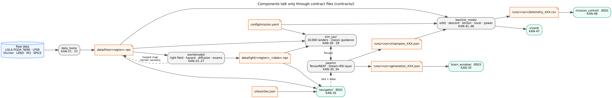

# Adinfinitium

**An autonomous lander + rover that land *where and when* a mission survives, tested by an evolving 10,000-mission swarm.**
NASA Space Apps Challenge 2026 · *Lunar Landing Site Navigator* · Pune · Imok, Nimansh, Tanush, Arnav



## Quick start (laptop, CPU)
```bash
pip install -e ".[dev]"
python -m contracts.mission              # validate config/mission.yaml + derived numbers
python -m data_tools.make_demo_tile      # synthetic crater tile (GENERATED — NOT OBSERVED)
python -m scripts.bench_swarm --n 1000   # fly 1,000 landers with classic guidance
pytest
```
On the RTX 4090: follow [`docs/plan/02_4090_SETUP_AND_PENDRIVE.md`](docs/plan/02_4090_SETUP_AND_PENDRIVE.md), then `make bench`.

## What works today
| Part | Status |
|---|---|
| `contracts/` — typed loaders + validators for every shared file | ✅ tested |
| `config/mission.yaml` — lander, rover, power, failures, scoring | ✅ validated (T/W 1.65, 1.32 with one engine out) |
| `sim_jax/` — 3-DOF JAX lander, vmap over N, failure injection, noisy sensors | ✅ tested |
| Classic ZEM/ZEV guidance (physics backup + baseline) | ✅ 99.7% success on the demo crater tile with failures on |
| World model, swarm, Basilisk modules, screens | ⏳ see Jira KAN |

## Repo map
| Folder | What | Owner |
|---|---|---|
| `contracts/` | shared file formats (the only cross-folder API) | Imok |
| `config/` | `mission.yaml` — every number | Imok / Tanush |
| `data_tools/` | data download + tiles | Imok |
| `worldmodel/` | light field, hazard U-Net, diffusion, exams | Imok |
| `sim_jax/` | GPU simulator + classic guidance | Imok |
| `swarm/` | TensorNEAT + Dream-RSI layer | Imok |
| `basilisk_mods/` | Basilisk modules + champion re-fly | Tanush, Arnav |
| `navigator/` | Streamlit :8501 | Nimansh |
| `mission_control/` | Streamlit :8502 | Arnav |
| `brain_window/` | Streamlit :8503 | Imok |
| `vizard/` | 3D replay | Arnav |
| `sites/` | site library | Tanush |

## Docs
- [System design](docs/SYSTEM_DESIGN.md) — requirements, components, contracts, scale, failure modes
- [Architecture decisions](docs/adr/) — ADR-001 … ADR-007
- [Diagrams](docs/diagrams/README.md)
- [Plan pack](docs/plan/) — project spec, 4090 setup, 48-hour schedule
- [Agent / contributor rules](AGENTS.md)

## Honesty rules
Every output is labelled **observed / modelled / generated / unknown**. Generated terrain is
always marked **GENERATED — NOT OBSERVED** and is never used alone for a safety claim.
Every AI part has a physics backup that runs first.

MIT License.
