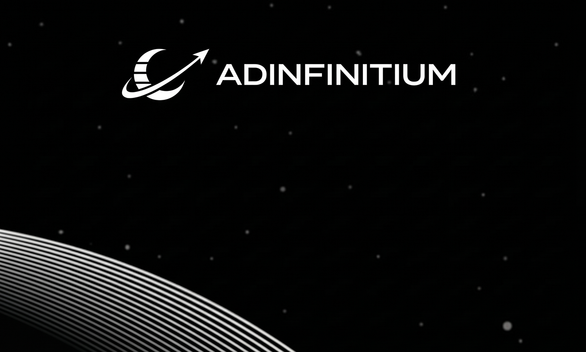

# Adinfinitium

**Open models for lunar landing-site navigation**, built from NASA LRO LOLA 5 m terrain of the lunar south pole.
Adinfinitium began as our NASA Space Apps 2026 project, *Lunar Landing Site Navigator*, plus a lunar-lander pilot.

Models were frozen before testing, held-out sites were evaluated once, and failures are reported next to successes.
All results are **simulation** results on held-out lunar sites. This is research code, **not for flight or safety-critical use**.

## Models

All weights and model cards are on Hugging Face: **https://huggingface.co/Imok282** (weights: Apache-2.0).

| Model | What it does | Params | Status |
|---|---|---|---|
| [lunar-hazard-unet](https://huggingface.co/Imok282/lunar-hazard-unet) | per-pixel slope hazard map | 60.4 M | final |
| [lunar-light-skyline](https://huggingface.co/Imok282/lunar-light-skyline) | skyline / illumination prediction | 38.3 M | final |
| [lunar-terrain-diffusion](https://huggingface.co/Imok282/lunar-terrain-diffusion) | terrain gap-filling | 49.9 M | experimental (kriging beats it) |
| [lunar-rover-brain](https://huggingface.co/Imok282/lunar-rover-brain) | scripted rover planner v3 / v3.1 | 0 learned | final |
| [lunar-lander-pilot](https://huggingface.co/Imok282/lunar-lander-pilot) | residual-on-classic landing guidance | 14.8 M | final |
| [lunar-rover-driver-v1](https://huggingface.co/Imok282/lunar-rover-driver-v1) / [v2](https://huggingface.co/Imok282/lunar-rover-driver-v2) | learned rover policies (PPO / imitation) | 11.4 M | **deprecated** (failed; research record) |

The chain: hazard network → light network → terrain model → rover brain → lander pilot. The hazard U-Net feeds the rover brain; the lander pilot is a separate package.

## Headline results (held-out, simulation)

| Model | Metric | Ours | Baseline |
|---|---|---|---|
| Hazard U-Net | F1, held-out Site23 + Site42 | **0.951** | 0.817 (slope rule) |
| Hazard U-Net | F1, six fresh sites | **0.757** | 0.292 |
| Light transformer | skyline MAE, Site23 + Site42 | **0.450°** | 0.570° |
| Lander pilot | landing success, 3 unseen maps | **98.39%** | 97.66% (classic) |
| Rover brain v3.1 | returned, four untouched sites | **33.7%** | 17.9% (naive planner) |
| Terrain diffusion | RMSE, held-out | 2.01 m | **0.97 m** (kriging wins) |

Known weaknesses are listed on every model card. In short: the hazard model is weak on flat fresh ground, the light model is ~227× slower than ray-casting, the lander's gain comes from one site and is not significant after correction, and the rover brain still loses over half its rovers.

## Repository layout

| Path | Contents |
|---|---|
| [`adinfinitium/`](adinfinitium/) | Main codebase: hazard, light and terrain models, rover simulator and brains (v1–v3.1), Dream-RSI self-improvement, tests, ops scripts |
| [`lander/`](lander/) | Lander pilot: 3-DOF terminal-descent simulator, classic ZEM/ZEV guidance, `PilotFormer`, benchmark and gate code |
| [`models/`](models/) | Model cards and benchmark charts (mirrors Hugging Face), `CHECKPOINTS.sha256` |
| [`docs/records/`](docs/records/) | Final results summaries, rover v3.1 and lander reports, Dream-RSI design |
| [`assets/`](assets/) | Logo and banner |

Large files are not in this repo: checkpoints are on Hugging Face, and the raw LOLA tiles, light samples and training logs are not published.
Each sub-project has its own `README.md` / `START_HERE.md` with setup instructions.

## Start here

1. [`docs/records/SUBMISSION_SUMMARY.md`](docs/records/SUBMISSION_SUMMARY.md): the full results, with numbers and caveats.
2. [`docs/records/RESULTS_FOR_TEAM.md`](docs/records/RESULTS_FOR_TEAM.md): per-model results and training notes.
3. [`adinfinitium/README.md`](adinfinitium/README.md) and [`lander/README.md`](lander/README.md): how to run the code.

## License

Code: MIT (see [`LICENSE`](LICENSE)). Model weights on Hugging Face: Apache-2.0. Terrain data: NASA LRO LOLA (public domain).
