<p align="center"></p>

<h1 align="center">Adinfinitium</h1>
<p align="center"><b>Autonomy that lands where missions survive.</b><br>
Landing-site navigation, landing autonomy and rover autonomy for the lunar south pole, built on real NASA data.</p>

<p align="center">
  <a href="https://adinfinitium.vercel.app"></a>
  <a href="https://huggingface.co/Imok282"></a>
  <a href="https://adinfinitium.vercel.app/landing.html"></a>
</p>
<p align="center">
  
  
  
  
  
  
  
</p>

<p align="center">
  <a href="https://adinfinitium.vercel.app">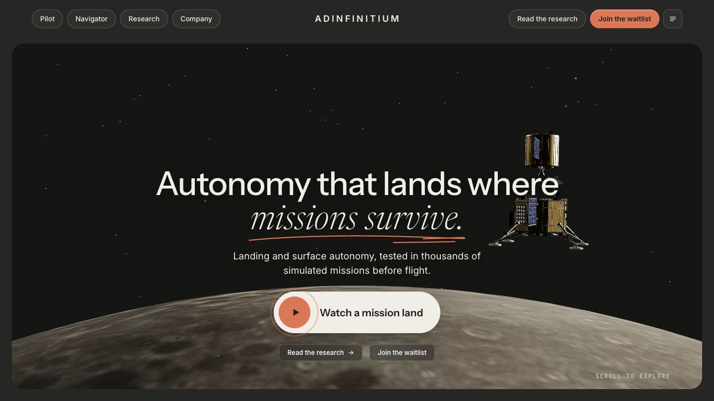</a>
</p>

---

## Contents

1. [Links](#links)
2. [The 60-second version](#the-60-second-version)
3. [Website tour](#website-tour)
4. [How it works](#how-it-works)
5. [Models](#models)
6. [Benchmarks](#benchmarks)
7. [Training](#training)
8. [Dream-RSI: safe self-improvement](#dream-rsi-safe-self-improvement)
9. [Safety and openness](#safety-and-openness)
10. [Data sources](#data-sources)
11. [Quick start](#quick-start)
12. [Reproduce the benchmarks](#reproduce-the-benchmarks)
13. [Repository layout](#repository-layout)
14. [Limitations](#limitations)
15. [Team, AI use and credits](#team-ai-use-and-credits)
16. [License](#license)

---

## Links

| | |
|---|---|
| 🌐 **Website** | **https://adinfinitium.vercel.app** · [Watch a landing](https://adinfinitium.vercel.app/landing.html) · [Benchmarks](https://adinfinitium.vercel.app/research/benchmarks.html) · [Mission control](https://adinfinitium.vercel.app/mission-control.html) · [Research](https://adinfinitium.vercel.app/research.html) |
| 🤗 **Hugging Face** | **https://huggingface.co/Imok282**: all seven models, weights and model cards |
| 💻 **Code** | https://github.com/Imok282/Adinfinitium (this repository) |
| 📄 **Full results** | [`docs/records/SUBMISSION_SUMMARY.md`](docs/records/SUBMISSION_SUMMARY.md) |

---

## The 60-second version

**The problem.** The lunar south pole holds the Moon's water ice and is the hardest place on it to land. *Where* and *when* you land
decide whether a mission survives: slope and boulders, sunlight that barely clears the horizon, and line of sight to Earth.

**What we built.** One autonomy stack, from lunar orbit to the ice:

- **Adinfinitium Navigator** chooses the landing cell and date. It combines NASA LRO LOLA 5 m terrain with NASA/JPL SPICE Sun,
  Earth and libration geometry, scores every candidate on slope, hazards, sunlight and Earth visibility, and flies the best ones in simulation.
- **Adinfinitium Pilot** is the onboard brain:
  - a **14.8 M-parameter transformer landing pilot** that only *corrects* classic ZEM/ZEV guidance (the physics backup always flies);
  - a **hazard U-Net** that maps unsafe ground;
  - a **horizon / sunlight model**;
  - a **rover brain** that drives to shadowed ice edges and back before the battery runs out.
- **Dream-RSI** keeps the models improving offline. A model may replace itself only if it loses no mission that the current model or the physics backup lands.

**Results** (paired, fixed-seed simulation; every model and its baseline fly identical missions):

| | Ours | Baseline |
|---|---|---|
| Lander: landing success on 3 unseen maps | **98.39 %** | 97.66 % (classic guidance) |
| Lander: at our planned landing site (Site 23, 2027-03-17) | **99.61 %** | 99.02 % |
| Lander: 20 brand-new procedural Moon maps | **98.12 %** | 97.50 % |
| Lander: fuel used | **≈ 9 % less in every test** | |
| Hazard map F1, fresh sites | **0.757** (2.6×) | 0.292 (slope rule) |
| Horizon error, held-out sites | **0.450°** (−21 %) | 0.570° (ray-cast) |
| Rover trips completed (strict) | **33.7 %** (≈ 1.9×) | 17.9 % (naive planner) |

---

## Website tour

The website tells the whole mission as a 3D scroll story and publishes every benchmark with its source.

<table>
<tr>
<td width="50%" valign="top"><a href="https://adinfinitium.vercel.app/research/benchmarks.html">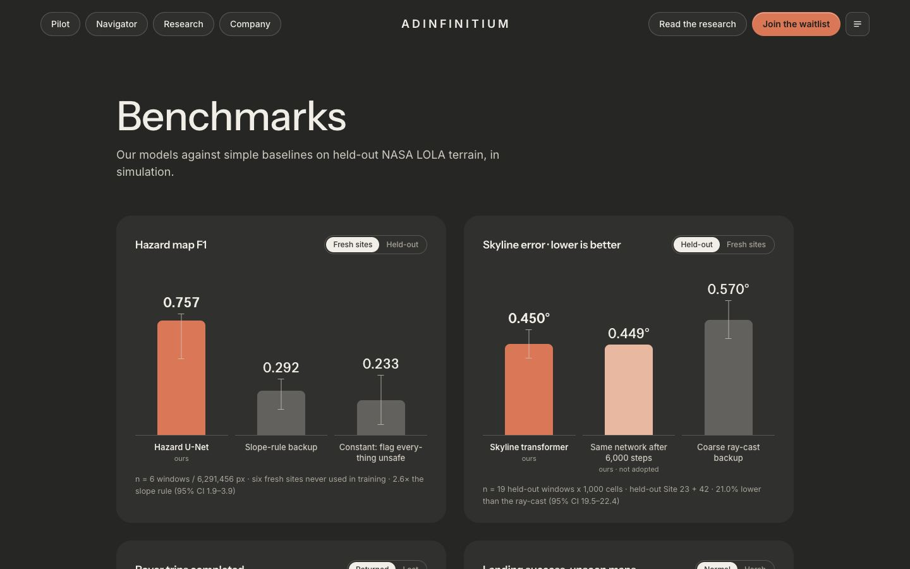</a><br><sub><b>Benchmarks.</b> Every model against its baseline, with n, test set and p-value under each chart.</sub></td>
<td width="50%" valign="top"><a href="https://adinfinitium.vercel.app/pilot.html#replay">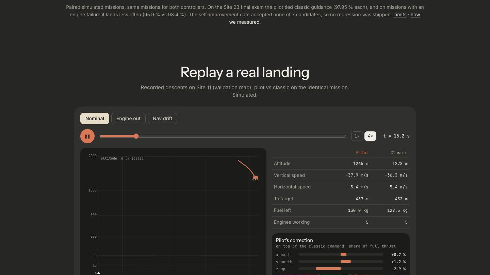</a><br><sub><b>Replay a real landing.</b> Recorded descents, pilot vs classic on the identical mission: paths, telemetry and the pilot's own corrections.</sub></td>
</tr>
<tr>
<td width="50%" valign="top"><a href="https://adinfinitium.vercel.app/mission-control.html">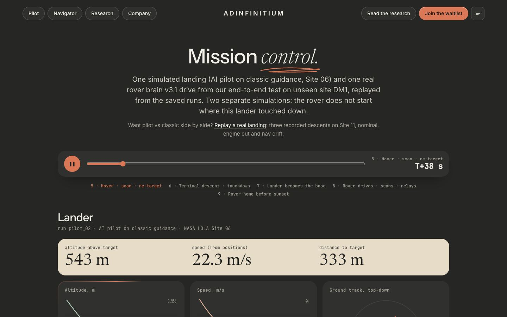</a><br><sub><b>Mission control.</b> A simulated landing and a real rover v3.1 drive, replayed step by step.</sub></td>
<td width="50%" valign="top"><a href="https://adinfinitium.vercel.app/landing.html"></a><br><sub><b>Watch a landing.</b> From lunar orbit, separation and powered descent to touchdown and the rover's first drive.</sub></td>
</tr>
</table>

---

## How it works

<table>
<tr>
<td width="50%" valign="top">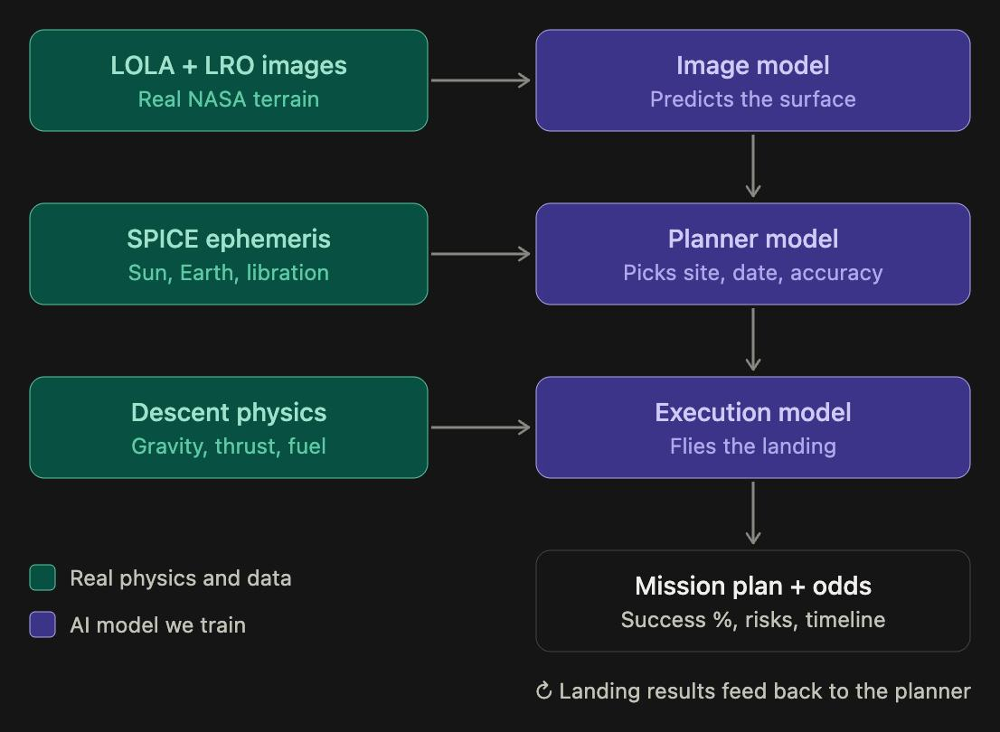<br><sub><b>Pipeline.</b> Real NASA data (LOLA terrain, SPICE ephemerides, descent physics) feeds the surface, planning and execution models; landing results feed back to the planner.</sub></td>
<td width="50%" valign="top">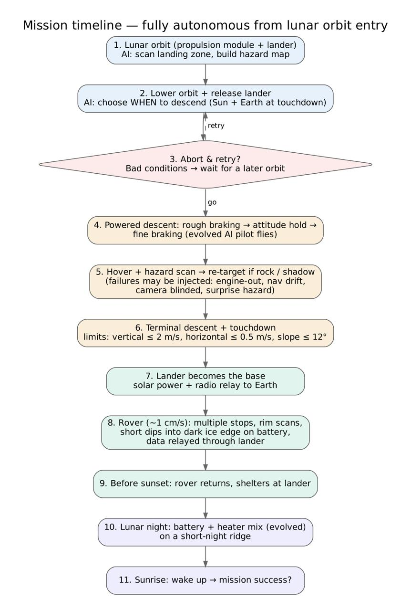<br><sub><b>Mission timeline (design).</b> Fully autonomous from lunar orbit: hazard scan, choose when to descend, powered descent, hover and re-target, touchdown, then the rover's surface mission.</sub></td>
</tr>
</table>

**Physics first.** Every learned model runs on top of a classical backup that works on its own:

| Learned model | Physics / classical backup | How they combine |
|---|---|---|
| Lander pilot (transformer) | ZEM/ZEV guidance | the pilot adds a bounded correction; an untrained pilot flies exactly like classic guidance |
| Hazard U-Net | slope rule on the LOLA DEM | the U-Net map feeds the rover's route cost; the rule is the fallback |
| Horizon / light model | coarse ray-cast | used where accuracy matters; ray-cast where speed matters |
| Terrain diffusion (experiment) | kriging | kriging ships; the network is kept as an experiment |
| Planner (set network / logistic) | Navigator ranking | the Navigator ranking ships until a learned planner beats it |

---

## Models

All weights and model cards are on Hugging Face: **https://huggingface.co/Imok282** (weights: Apache-2.0).

| Model | What it does | Params | Status |
|---|---|---|---|
| [lunar-lander-pilot](https://huggingface.co/Imok282/lunar-lander-pilot) | residual-on-classic landing guidance (PPO) | 14.8 M | final |
| [lunar-hazard-unet](https://huggingface.co/Imok282/lunar-hazard-unet) | per-pixel slope hazard map | 60.4 M | final |
| [lunar-light-skyline](https://huggingface.co/Imok282/lunar-light-skyline) | 360° horizon / illumination prediction | 38.3 M | final |
| [lunar-terrain-diffusion](https://huggingface.co/Imok282/lunar-terrain-diffusion) | terrain gap-filling | 49.9 M | experimental (kriging beats it) |
| [lunar-rover-brain](https://huggingface.co/Imok282/lunar-rover-brain) | scripted rover planner v3 / v3.1 | 0 learned | final |
| [lunar-rover-driver-v1](https://huggingface.co/Imok282/lunar-rover-driver-v1) / [v2](https://huggingface.co/Imok282/lunar-rover-driver-v2) | learned rover policies (PPO / imitation) | 11.4 M | deprecated (failed; research record) |

---

## Benchmarks

Paired fixed-seed design throughout. Touchdown success = vertical ≤ 2 m/s, horizontal ≤ 0.5 m/s, slope ≤ 12°.
Interactive charts: **[adinfinitium.vercel.app/research/benchmarks.html](https://adinfinitium.vercel.app/research/benchmarks.html)**.

### Lander pilot vs classic ZEM/ZEV guidance

| Test | n / condition | Classic | Pilot | Pilot − classic [95 % CI] | Exact McNemar p |
|---|---|---|---|---|---|
| 3 unseen maps (Site 42, Shoemaker, DM2), normal | 2,304 | 97.66 % | **98.39 %** | +0.74 pts [+0.16, +1.32] | 0.019 |
| 3 unseen maps, harsh (3× failure rates) | 2,304 | 96.31 % | **96.92 %** | +0.61 pts [−0.23, +1.44] | 0.18 |
| Site 23 final exam (flown once), normal | 1,024 | 97.95 % | 97.95 % | 0.00 | 1.00 |
| Site 23 final exam, harsh | 1,024 | 96.48 % | 96.29 % | −0.20 pts | 0.88 |
| Planned landing cell (rehearsal), normal | 512 | 99.02 % | **99.61 %** | +0.59 pts [−0.4, +1.6] | 0.45 |
| Planned landing cell (rehearsal), harsh | 512 | 99.22 % | 99.02 % | −0.20 pts [−1.3, +1.0] | 1.00 |
| 20 procedural Moon maps, normal | 640 | 97.50 % | **98.12 %** | +0.63 pts [−0.3, +1.6] | 0.34 |
| 20 procedural Moon maps, harsh | 640 | 96.72 % | **97.50 %** | +0.78 pts [−0.6, +2.1] | 0.36 |

Fuel: **≈ 9 % less in every test** (65.0 vs 71.5 kg on unseen maps). Same miss distance (≈ 4 m).

### Hazard, light, terrain

| Model | Metric | Ours | Baseline |
|---|---|---|---|
| Hazard U-Net | F1, held-out Site 23 + 42 | **0.951** | 0.817 (slope rule) |
| Hazard U-Net | F1, six fresh sites | **0.757** | 0.292 (slope rule) |
| Horizon transformer | skyline MAE, held-out | **0.450°** | 0.570° (ray-cast) |
| Horizon transformer | skyline MAE, fresh sites | **0.243°** | 0.321° |
| Horizon transformer | sunlit-hours error | **7.6 h** | 10.5 h |
| Terrain | RMSE, held-out | 2.01 m (diffusion) | **0.97 m (kriging, shipped)** |

<table>
<tr>
<td width="50%" valign="top">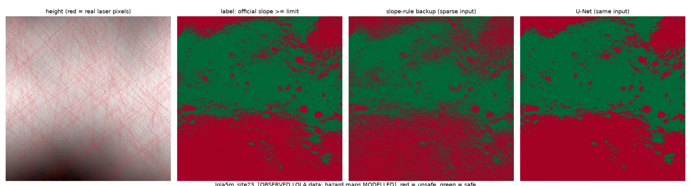<br><sub><b>Hazard model, held-out Site 23:</b> U-Net vs slope rule vs LOLA truth.</sub></td>
<td width="50%" valign="top">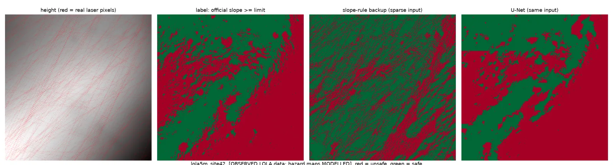<br><sub><b>Hazard model, held-out Site 42.</b></sub></td>
</tr>
</table>

### Planner (Site 23, 7 dates × 96 candidates)

| Method | Chosen-candidate success | Regret |
|---|---|---|
| Logistic planner (14 params) | **15.2 %** | 27.2 pts |
| Navigator ranking (shipped) | 12.8 % | 29.6 pts |
| PlannerSetNet (646 k params) | 12.2 % | 30.2 pts |

### Rover (4 untouched sites × 4 dates, 8,192 runs per method, strict rule)

| Method | Returned | Lost |
|---|---|---|
| **Rover brain v3.1** | **33.7 %** | 53.9 % |
| Rover brain v3 | 31.0 % | 61.0 % |
| Naive planner | 17.9 % | 81.8 % |
| Learned driver v1 (PPO) | 0.0 % | failed |
| Learned driver v2 (imitation) | 1.2 % | failed |

<p align="center">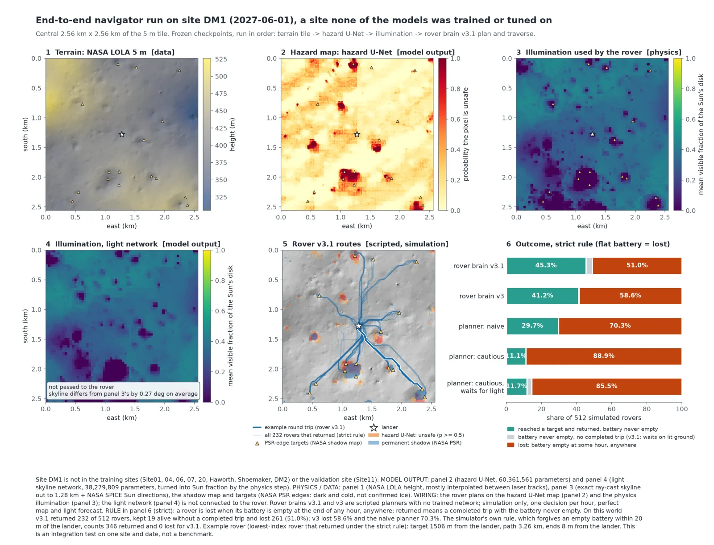<br><sub><b>Rover brain v3.1, end-to-end test on site DM1:</b> the hazard map feeds the route to a shadowed ice edge and back.</sub></p>

---

## Training

Two days of real training on an RTX 3050 PC and Apple-silicon Macs.

<table>
<tr>
<td width="50%">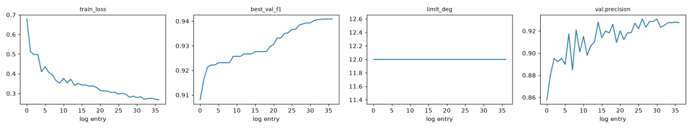<br><sub>Hazard U-Net: validation F1 0.908 → 0.941.</sub></td>
<td width="50%">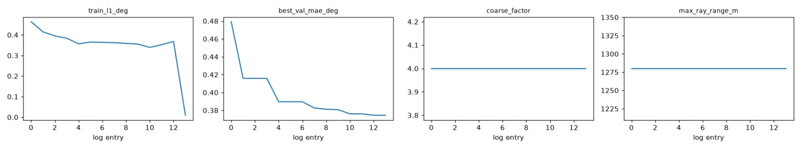<br><sub>Horizon transformer: validation MAE 0.479° → 0.375°.</sub></td>
</tr>
<tr>
<td width="50%">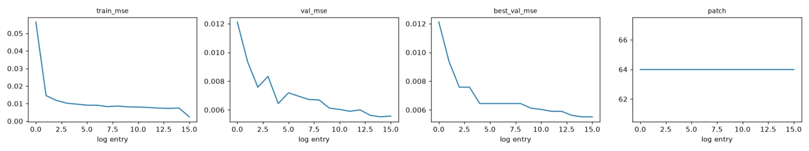<br><sub>Terrain diffusion: validation MSE 0.0121 → 0.0055.</sub></td>
<td width="50%">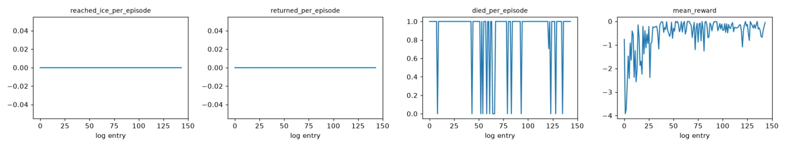<br><sub>Learned rover driver v1: never succeeded in training (kept as a research record).</sub></td>
</tr>
</table>

---

## Dream-RSI: safe self-improvement

1. **Find failures:** fly or replay missions and record where the current model fails.
2. **Dream harder:** replay those hard cases and retrain a candidate, warm-started from the current model.
3. **Gate:** score the candidate on a frozen validation exam, paired with the current model and the physics backup. The lander gate accepts only a candidate that loses **no** mission either of them lands, and improves total success.
4. **Repeat** from whichever model won. The shipped model never gets worse.

| Loop | Accepted | Effect |
|---|---|---|
| Planner | 1 of 5 | validation Brier 0.01543 → 0.01353 (−12 %) |
| Lander pilot | 0 of 7 | unchanged: the zero-regression gate held |
| Rover brain v3.1 | 9 of 36 | repaired planted faults: blocked route fixed at 4/4 sites, late light 3/4 |
| Rover brain v3 | 9 of 72 | blocked route fixed at 6/6 sites |

<p align="center">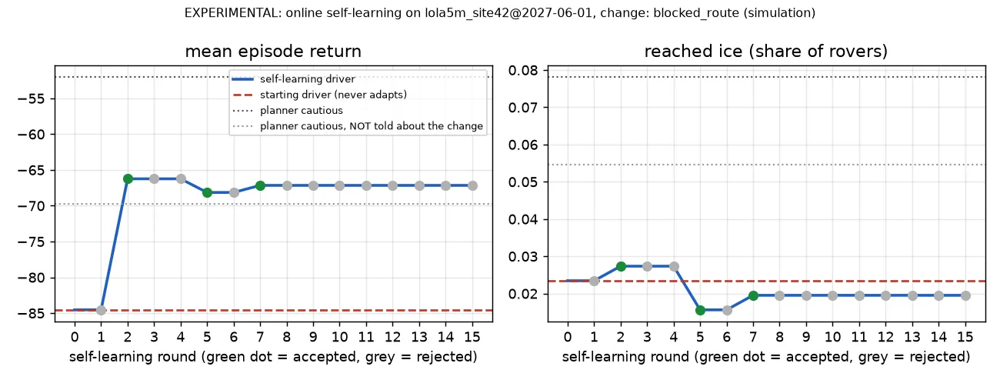<br><sub>Rover self-learning on Site 42 with a blocked route.</sub></p>

---

## Safety and openness

- **Physics backup first.** Learned parts only correct a classical controller that always works on its own.
- **Zero-regression gate.** No self-improved model ships unless it loses no mission the current model or the backup lands.
- **Held-out testing.** Models were frozen before testing; the Site 23 final exam was flown exactly once; procedural Moon maps give never-seen terrain.
- **Open by default.** All seven models are on [Hugging Face](https://huggingface.co/Imok282); code, benchmark data and the methodology are public.
- **Honest numbers.** Every number on the website names its source file; failures are reported next to successes.

---

## Data sources

| Data | Source |
|---|---|
| Lunar south-pole terrain, 5 m/pixel | [NASA LRO LOLA, PGDA product 90](https://pgda.gsfc.nasa.gov/products/90) · [5 m tiles](https://pgda.gsfc.nasa.gov/data/LOLA_5mpp/) · [20 m DEM](https://pgda.gsfc.nasa.gov/data/LOLA_20mpp/) |
| Sun, Earth and lunar orientation | [NASA/JPL NAIF SPICE](https://naif.jpl.nasa.gov/naif/) ([generic kernels](https://naif.jpl.nasa.gov/pub/naif/generic_kernels/), DE440) |
| Moon colour and elevation (website) | [NASA SVS CGI Moon Kit](https://svs.gsfc.nasa.gov/4720) (LROC, LOLA) |
| Touchdown limits | [ISRO Chandrayaan-3](https://www.isro.gov.in/Chandrayaan3_Details.html) |
| Spacecraft simulation | [Basilisk](https://avslab.github.io/basilisk/) + Vizard (AVS Lab, CU Boulder) |

No NASA endorsement implied. All mission results are simulation.

**Built with:** Python, PyTorch, JAX, NumPy, SciPy, SpiceyPy, Rasterio, Basilisk, Streamlit, Blender, three.js, Motion.

---

## Quick start

```bash
git clone https://github.com/Imok282/Adinfinitium.git && cd Adinfinitium/lander
pip install -e ".[dev]"                      # Python 3.11+, CPU is fine
python -m contracts.mission                  # validate the mission config (lander, rover, failures, limits)
python -m data_tools.make_demo_tile          # synthetic crater tile, no NASA download needed (GENERATED, NOT OBSERVED)
python -m scripts.bench_swarm --n 1000       # fly 1,000 landers with classic guidance
pytest                                       # the test suite
```

Trained weights: `huggingface-cli download Imok282/lunar-lander-pilot` (and the other models under [Imok282](https://huggingface.co/Imok282)).
Real terrain: LOLA 5 m south-pole tiles from [PGDA](https://pgda.gsfc.nasa.gov/products/90).
Per-project setup: [`lander/README.md`](lander/README.md) and [`adinfinitium/README.md`](adinfinitium/README.md).

## Reproduce the benchmarks

```bash
python -m worldmodel.lander.benchmark --n 256 --seeds 3 --harsh 3                 # 3 unseen maps, normal + harsh
python -m worldmodel.lander.mission_bench rehearsal --n 512 --batch 256           # planned landing cell
python -m worldmodel.lander.mission_bench procedural --maps 20 --n 32 --batch 32  # 20 procedural Moon maps
```

The full method (paired design, held-out sites, Wilson and exact McNemar statistics, Holm correction, data provenance) is on the
[methodology page](https://adinfinitium.vercel.app/research/methodology.html).

---

## Repository layout

| Path | Contents |
|---|---|
| [`adinfinitium/`](adinfinitium/) | Main codebase: hazard, light and terrain models, rover simulator and brains (v1–v3.1), Dream-RSI, tests, ops scripts |
| [`lander/`](lander/) | Lander pilot: 3-DOF terminal-descent simulator, classic ZEM/ZEV guidance, `PilotFormer`, benchmark and gate code |
| [`models/`](models/) | Model cards and benchmark charts (mirrors Hugging Face), `CHECKPOINTS.sha256` |
| [`docs/records/`](docs/records/) | Final results summaries, rover v3.1 and lander reports, Dream-RSI design |
| [`assets/`](assets/) | Logo, banner and README images |

Large files are not in this repo: checkpoints are on Hugging Face; raw LOLA tiles, light samples and training logs are not published.

## Start here

1. [`docs/records/SUBMISSION_SUMMARY.md`](docs/records/SUBMISSION_SUMMARY.md): the full results, with numbers and caveats.
2. [`docs/records/RESULTS_FOR_TEAM.md`](docs/records/RESULTS_FOR_TEAM.md): per-model results and training notes.
3. [`adinfinitium/README.md`](adinfinitium/README.md) and [`lander/README.md`](lander/README.md): how to run the code.

---

## Limitations

- **Simulation only.** The lander simulator is a simplified 3-DOF terminal descent; the rover simulator is kinematic.
- **Lander:** worse than classic after an engine failure (95.9 % vs 98.4 %); most remaining crashes are sideways touchdowns just over 0.5 m/s; the unseen-map gain comes from Site 42 and is not significant after correcting for multiple tests.
- **Hazard:** weak on flat ground; about 90 % of label pixels are NASA interpolation.
- **Light:** about 227× slower than ray-casting; not yet wired into the rover.
- **Rover:** the best brain is scripted; both learned drivers failed; v3.1 still loses over half its rovers.
- **Swarm / NEAT:** designed, not yet run.
- **Test sites:** every real test site has now been used at least once; the procedural Moon maps are the only never-seen terrain.

---

## Team, AI use and credits

**Team:** Ojas · Nimansh · Tanush · Arnav. NASA Space Apps Challenge 2026, *Lunar Landing Site Navigator*.

**AI use.** The team built the software together with AI coding agents (Claude Code).

**Credits.** Terrain: NASA LRO LOLA (PGDA). Imagery: NASA/GSFC/Arizona State University (LROC). Ephemeris: NASA/JPL SPICE (DE440).

## License

Code: MIT (see [`LICENSE`](LICENSE)). Model weights on Hugging Face: Apache-2.0. Terrain data: NASA LRO LOLA (public domain).
