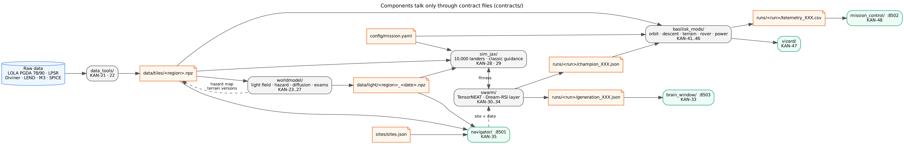
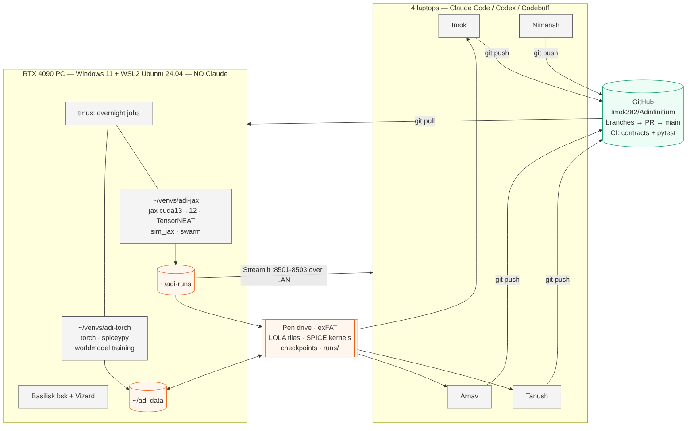
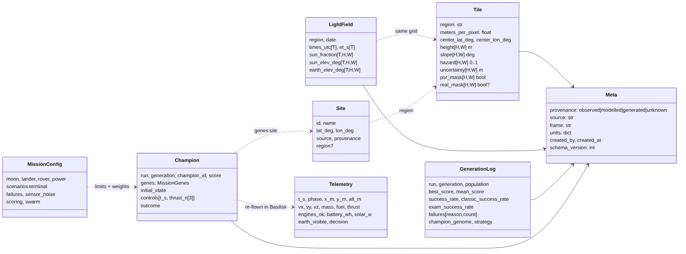
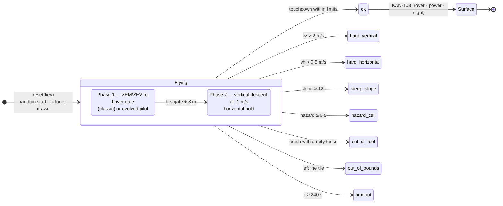
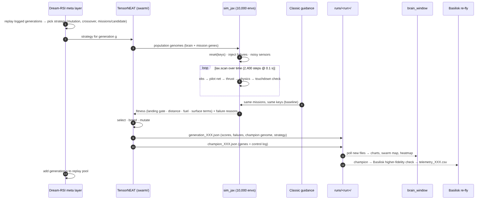

# Adinfinitium — System Design

**Status:** v1 · Sat 14 Nov 2026 · owner: Imok · decisions recorded in [`docs/adr/`](adr/)
**Challenge:** NASA Space Apps 2026 — *Lunar Landing Site Navigator*
**One line:** an autonomous lander + rover that land **where and when** a mission survives,
tested by an evolving 10,000-mission swarm, with exact physics behind every AI part.

Background, numbers and the 48-hour plan live in [`docs/plan/`](plan/) (the plan pack).
**Jira (project KAN) is the source of truth for who owns what.** Some owner names in the plan
pack predate it.

---

## 1. Requirements

### 1.1 Functional (traced to the challenge brief)

| # | Requirement | Where |
|---|---|---|
| F1 | Compare candidate sites and dates on Sun visibility, power, and direct-to-Earth (DTE) windows | navigator/ |
| F2 | Sun and Earth position vs the **local horizon**: LOLA terrain plus lunar curvature, no refraction, libration included | worldmodel/ light-field teacher, SPICE |
| F3 | Countdowns to sunset and Earthset, plus a lunar-day timeline | navigator/ |
| F4 | Safe landing: touchdown within vertical ≤ 2 m/s, horizontal ≤ 0.5 m/s, slope ≤ 12° | sim_jax/, basilisk_mods/ |
| F5 | The rover reaches ice targets and returns; the lander relays data to Earth | sim_jax/ surface phase (KAN-103) |
| F6 | The mission survives the lunar night and wakes at sunrise | sim_jax/ power + thermal model |
| F7 | An evolved pilot beats classic guidance on unseen terrain (the "intelligence score") | swarm/, worldmodel/ exams |
| F8 | Higher-fidelity re-flight and 3D replay of the champions | basilisk_mods/, vizard/ |
| F9 | Every number is labelled observed / modelled / generated / unknown | contracts/provenance.py |

### 1.2 Non-functional

| Quality | Target | How |
|---|---|---|
| Throughput | 10,000 missions per generation; ≥ 300 generations overnight on one RTX 4090 | JAX `vmap` + `lax.scan`, single-GPU, no host round-trips inside an episode |
| Correctness | Light-field teacher Sun/Earth angles match JPL Horizons at ≥ 3 sites and dates | KAN-22, KAN-23 validation |
| Robustness | Every AI part has a physics backup that runs **first** | rule 5, §7 |
| Honesty | No generated data is presented as observed | `Meta.provenance`, UI banner |
| Team velocity | 4 people (2 vibe-coders) work in parallel without blocking | file contracts (ADR-002), demo tile |
| Ops | The 4090 has no Claude, so everything there is a scripted command | `make`, `scripts/`, plan doc 02 |

### 1.3 Constraints
- **48 hours.** Checkpoint 1 Sat 21:00 · cut rule Sun 12:00 · code freeze Sun 17:00 · submit Sun 22:00 IST.
- **Hardware:** one RTX 4090 (Windows 11 + WSL2 Ubuntu 24.04) plus four laptops. Big data moves by pen drive.
- **Libraries:** TensorNEAT needs JAX. Basilisk is Python-first (`pip install bsk`), with modules written in Python, not C++.
- **Data:** about 90% of the 5 m LOLA pixels are interpolated, so terrain uncertainty is a first-class output.

---

## 2. High-level design

The overall architecture and mission phases are in [01_system_architecture](diagrams/01_system_architecture.png)
and [02_mission_phases](diagrams/02_mission_phases.png).

**Three lanes run in parallel and meet only at files:**
1. **World lane** (data_tools → worldmodel): turns raw LOLA, ice and SPICE data into tiles and light fields.
2. **Swarm lane** (sim_jax ↔ swarm): flies 10,000 missions per generation, evolves pilots plus mission genes, and writes logs and champions.
3. **Fidelity and screens lane** (basilisk_mods, vizard, navigator, mission_control, brain_window): re-flies the champions, shows everything, and answers the brief directly.

### 2.1 Deployment

| Machine | Runs | Gets code by | Gets data by |
|---|---|---|---|
| Laptops (×4) | editing, tests, Streamlit apps, Basilisk (light) | git | pen drive |
| RTX 4090 PC | data prep, world-model training, swarm overnight, Basilisk re-fly | `git pull` | pen drive |
| GitHub | source of truth, CI (contracts + pytest on CPU) | — | — |

Two Python environments on the 4090 (`adi-jax`, `adi-torch`) keep JAX and PyTorch CUDA wheels
apart (ADR-001). Streamlit screens can serve from the 4090 over the LAN.

---

## 3. Data contracts (the API)

There is no network API. The modules are batch producers and consumers, so the "API" is the
set of versioned files below. Each file has a typed loader and validator in `contracts/` and a
round-trip test (ADR-002).

| File | Producer → consumer | Loader | Key invariants |
|---|---|---|---|
| `config/mission.yaml` | Imok/Tanush → everyone | `contracts.mission.load_mission` | Unknown keys rejected. Terminal start mass − propellant = dry mass. Hover possible with one engine out |
| `data/tiles/<region>.npz` | data_tools / worldmodel → sim, Basilisk, Navigator | `contracts.tiles.load_tile` | All grids [H,W] and finite. Hazard in [0,1]. Slope in [0,90]. Row 0 = north |
| `data/light/<region>_<date>.npz` | worldmodel → sim, Navigator | `contracts.light.load_light` | Same grid as the tile. `et_s` strictly increasing. `sun_fraction` in [0,1] |
| `sites/sites.json` | Tanush → everyone | `contracts.sites.load_sites` | Unique snake_case ids |
| `runs/<run>/generation_XXX.json` | swarm → brain_window | `contracts.runs.read_generation` | Failure reasons from `FAILURE_REASONS` |
| `runs/<run>/champion_XXX.json` | swarm → Basilisk (KAN-34 → KAN-43) | `contracts.runs.read_champion` | Control log thrust in tile ENU, N |
| `runs/<run>/telemetry_XXX.csv` | Basilisk → mission_control | `contracts.runs.read_telemetry` | Exact column order `TELEMETRY_COLUMNS` |

**Shared rules:** every file carries `Meta` (provenance, source, frame, units, created_by,
created_at, schema_version). The default frame is `MOON_ME_DE440_ME421`; local tile grids are
ENU metres centred on the tile. Breaking changes bump `schema_version`.

---

## 4. Deep dive: the swarm simulator (`sim_jax/`)

### 4.1 Environment
- **Dynamics:** 3-DOF point mass, uniform g = 1.62 m/s², semi-implicit Euler at dt = 0.1 s, mass flow |T| / (Isp·g0). It is gymnax-style and pure (`reset(key)`, `step(key, state, action)`), so it `jit`s and `vmap`s.
- **Action:** a thrust vector in [-1,1]³ × max thrust. The env enforces a tilt cone (≤ 45° from vertical), the healthy-engine ceiling, the min-throttle floor (or engines off), and no thrust once propellant is gone.
- **Observation (13):** estimated offset to target, radar altitude, velocity, fuel/engine/mass fractions, hazard and slope below (zeroed if the camera is blind), camera flag, time fraction. The AI pilot and the classic baseline see **the same noisy vector**.
- **Failure injection, per mission:** engine out at a random time, nav drift (velocity bias that accumulates into position error), camera blind. Surprise hazards come next in KAN-104.
- **Outcomes** (state machine below): `ok`, `hard_vertical`, `hard_horizontal`, `steep_slope`, `hazard_cell`, `out_of_fuel`, `out_of_bounds`, `timeout`. These are the shared vocabulary for the failure heatmap and the decision log.

### 4.2 Classic guidance (physics backup and baseline)
- **Phase 1:** ZEM/ZEV optimal feedback (Guo, Hawkins & Wie 2013) to a hover gate 30 m above the target, with a time-to-go re-estimated every step.
- **Phase 2:** from 8 m above the gate, vertical descent at −1 m/s with a horizontal PD hold. The 8 m margin is much larger than the 1 m altimeter noise, which stops the controller from switching back and forth at the gate.

Results measured today on CPU with sensor noise on:

| Terrain | Failures | Success | Main failure |
|---|---|---|---|
| flat | off | 99.5% | — |
| flat | on | 99.3% | hard_horizontal (nav drift) |
| demo crater tile (GENERATED) | off | 100% | — |
| demo crater tile (GENERATED) | on | 99.7% | hard_horizontal (nav drift) |

The baseline is strong on a clear target. **The AI has to win where classic guidance can't:**
targets near hazards, surprise rocks, re-targeting, choosing the site and time, and surviving
on the surface. Exams (KAN-27) must be built to test exactly those cases. Otherwise the
intelligence score is meaningless.

### 4.3 One generation, end to end

See also [03_evolution_loop](diagrams/03_evolution_loop.png) and [04_bot_io](diagrams/04_bot_io.png).

### 4.4 Scoring
The landing gate comes first: an unsafe landing scores 0. Then `w_landed − w_dist·distance − w_fuel·fuel`.
Surface terms (ice reached, rover returned, night survived, data sent) are added in KAN-103.
All weights are in `mission.yaml` → `scoring` and are shown on screen.

---

## 5. Load estimation and scale

| Quantity | Value | Note |
|---|---|---|
| Steps per episode | 2,400 | 240 s at 0.1 s |
| Lander-steps per generation | 10,000 × 2,400 = **24 M** | plus one classic-baseline pass on the same keys |
| Measured CPU throughput | **≈ 1.8 M lander-steps/s** (sandbox CPU, classic policy) | ≈ 13 s per generation on CPU |
| 4090 throughput | **must be measured (KAN-101)** | target: compiled generation < 10 s, so 300 generations fit in < 1 h of sim time |
| Network eval cost | grows with NEAT genome size | TensorNEAT pads genomes to fixed max nodes/conns; keep max ≤ 64 nodes |
| GPU memory | state ≈ 30 floats × 10k, so small; `record=True` trajectories are 10k × 2,400 × 10 floats ≈ 1 GB | record only champions, never the full population |
| Tile size | 400×400 @ 5 m ≈ 3 MB `.npz` | full 20 m polar LDEM is several GB: cut regions in KAN-21, never load it whole |
| Run output | ≈ 10 KB per generation JSON, ≈ 100 KB per champion | 300 generations ≈ 30 MB, fits the pen drive easily |

**Scaling knobs, in order of use:** population size, episode dt (0.1 → 0.2 s in the high
phase), number of terrain versions per candidate (the Dream-RSI layer tunes this), and
`float32` throughout.

---

## 6. Reliability, failure modes and the cut rule

| Failure | Detection | Mitigation |
|---|---|---|
| JAX CUDA wheel mismatch on the 4090 | `bench_swarm` CHECK fails | fall back `jax[cuda13]` → `jax[cuda12]`; CPU run still proves the logic |
| TensorNEAT API or performance surprise | KAN-30 wrapper test | fixed-topology network with evolved weights (KAN-106) |
| Real LOLA tiles late | — | everyone develops on `data_tools.make_demo_tile` (GENERATED label) |
| Neural light field inaccurate | error map vs teacher | the exact ray-cast teacher is used directly (slower, always correct) |
| Hazard U-Net fails on real tiles | precision/recall on real hold-out | slope ≥ 12° threshold map (`hazard_from_slope`) |
| Diffusion terrain not credible | hide-and-check vs LDEM_ERR noise | LDEM_ERR Gaussian noise versions |
| Basilisk descent module unfinished | KAN-42 | champions replayed in the JAX sim plus a Vizard-less 2D plot |
| Overnight job dies | tmux + per-generation files | resume from the last `generation_XXX.json` (KAN-105 must support `--resume`) |
| Someone breaks `main` | CI | branch-only rule, PR + green CI before merge |

**Cut rule, Sun 12:00:** any AI part not beating its backup is swapped for the backup in the
demo and becomes a "next step" slide.

**Monitoring:** the brain window *is* the monitor. Success rate, failure counts and wall time
per generation are written every generation. A generation file not updating means the run is dead.

---

## 7. AI parts and their physics backups

| AI part | Backup (runs first) | Validation shown to judges | Jira |
|---|---|---|---|
| Neural light field f(x,y,t) | exact horizon ray-cast + SPICE | error map; teacher vs JPL Horizons | KAN-23/24 |
| Hazard U-Net | LDSM slope ≥ 12° | precision/recall on **real** unseen tiles | KAN-25 |
| Diffusion terrain versions | LDEM_ERR noise | hide-and-check error vs backup | KAN-26 |
| NEAT pilot + mission genes | ZEM/ZEV classic guidance | AI vs physics on identical missions; unseen-terrain exam | KAN-28/30 |
| Dream-RSI meta layer | fixed evolution hyper-parameters | A/B plot: score vs generation with and without it | KAN-31 |

---

## 8. Trade-offs (summary; full ADRs in `docs/adr/`)

| Decision | Chosen | Over | Because | Cost |
|---|---|---|---|---|
| ADR-001 | JAX for the swarm sim | PyTorch / NumPy / Isaac | TensorNEAT is JAX; vmap + scan keeps all 10k landers on-GPU | two CUDA venvs; JAX learning curve |
| ADR-002 | file contracts | services / DB / queue | zero coordination cost for 4 people in 48 h; works offline over pen drive | no live streaming; consumers poll files |
| ADR-003 | neuroevolution (NEAT) | PPO / RL | gradient-free with a gated fitness; evolves mission genes too; the brain is drawable for judges | sample-hungry, which the 10k-parallel sim pays for |
| ADR-004 | two fidelities: JAX 3-DOF swarm + Basilisk re-fly | Basilisk only | Basilisk can't fly 10k missions per generation; JAX can't claim flight fidelity | must show agreement between the two |
| ADR-005 | exact teacher + neural student light field | neural only / exact only | instant queries for the swarm, with an always-correct fallback | training time on the 4090 |
| ADR-006 | Streamlit for the 3 screens | React / Dash | vibe-coders can build it; Python-only | less control over the look |
| ADR-007 | provenance labels everywhere | none | judges' Validity score; 90% interpolated data | small UI clutter |

---

## 9. What we'd revisit as it grows
1. **6-DOF attitude** (reaction wheels plus 58 N thrusters) instead of the tilt-cone 3-DOF.
2. **Point-mass lunar gravity and orbit phases inside JAX**, so site and time genes are evolved end to end, not only from the hover gate.
3. **A streaming bus** (e.g. ZeroMQ) instead of file polling, if the screens need under 1 s of latency.
4. **Multi-GPU / pmap** if the population or terrain versions grow by 10×.
5. **Recurrent or memory pilots** (KAN-32) once the feed-forward NEAT pilot plateaus.
6. **A proper uncertainty model:** a Bayesian combination of LOLA spot density, LDEM_ERR and diffusion spread.
