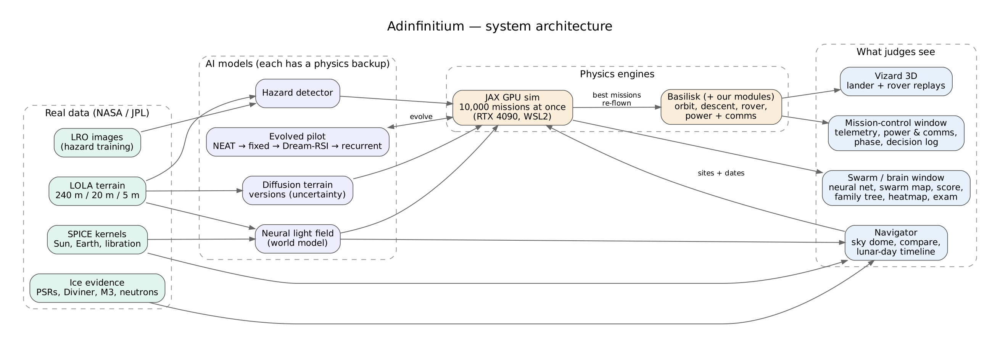
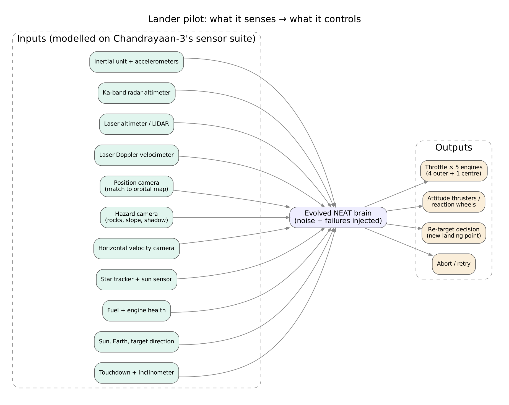
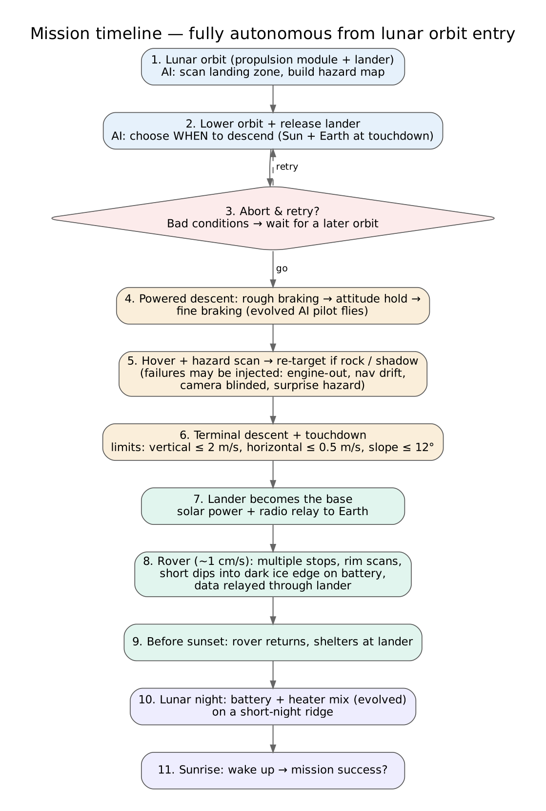
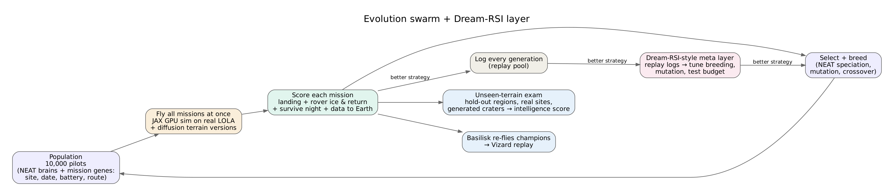

# 0. One-page summary

**What it is:** an AI system that plans and flies a fully autonomous lunar south-pole mission (lander + rover), and shows mission planners, educators and the public *where and when* a mission can land, keep sunlight and Earth contact, and survive.

**One sentence for judges (draft):** *Our AI learns the Moon, evolves 10,000 autonomous landers in parallel, and shows which site and date let a lander and rover land, reach ice, talk to Earth and survive the lunar night.*

**Challenge:** Lunar Landing Site Navigator (Advanced / Intermediate). Every feature below is mapped to a line of the brief in Section 2.

**Status:** planned only. Nothing is implemented or validated yet. Never present a planned feature as a result.

**Decided:**

| Topic | Decision |
|---|---|
| Company | Adinfinitium (product name: decide Sunday) |
| Hardware | Our own design: propulsion module + ~1,500 kg lander (5 engines) + ~25 kg Pragyan-class rover |
| Autonomy | From lunar orbit entry to touchdown, rover operations and night survival |
| Physics | JAX GPU simulator (10,000 missions at once) + Basilisk with our own modules (orbit, descent, rover, power/comms) |
| AI | Hazard detector, diffusion terrain versions, neural light field, evolved pilot (NEAT → fixed → Dream-RSI layer → recurrent) |
| Rule | Every AI part has a physics backup; if AI isn't ready by Sun 12:00, the backup goes in the demo |
| Screens | Navigator, mission-control window, swarm/brain window, Vizard 3D |
| Dates | Mission window 2027–2028 |
| Video | 30 s; 60% lander / 20% rover / 20% Navigator; hero moment "intelligence rising"; technique decided later (Claude + Grok ideas) |
| Team | Imok (4090 PC + world-model AI), Nimansh (swarm + brain), Tanush (Basilisk + Vizard + mission control), Arnav (Navigator + data + tests) |

**Still open:** product name, video storyboard, the exact local submission deadline, and submission format (check the live Project Submission Guide).

# 1. Why this can win (and the honest limits)

- **Relevance:** the Navigator covers the brief's objectives directly: sites, dates, Sun/Earth vs horizon, power, Earth contact, sunset/Earthset countdowns, timelines.
- **Creativity:** existing landing AIs optimise the touchdown, and existing site-selection tools rank map pixels. **To our knowledge**, nobody has evolved landers whose fitness includes surviving *after* touchdown (sunlight, Earth contact, rover science, lunar night).
- **Validity:** real NASA/JPL data (LOLA, SPICE), checked against JPL Horizons; Basilisk cross-checks our GPU simulator; unseen-terrain exam; AI vs physics baseline.
- **Impact:** helps teams re-plan quickly when launches slip, which is exactly the brief's scenario. It also explains to students why the south pole is hard.
- **Presentation:** Vizard 3D landing, evolving swarm, live neural network, "intelligence rising."

**Honest limits (say these out loud):** this is an educational, low-fidelity simulation, not flight software. Terrain at 5 m is ~90% interpolated. Diffusion output is *generated*, not observed. Temperature and night survival use simplified models. The highest score is not "safe," only "best under these assumptions."

# 2. Challenge fit: brief line → our feature

| Brief objective / consideration | Our feature | Owner |
|---|---|---|
| Curated list of notable sites | Navigator site library: Apollo, CLPS targets, Chandrayaan-3, Chang'e, IM-2 area, Artemis III candidate regions | Arnav |
| Custom coordinates | Not in v1 (decided); add later | — |
| Side-by-side comparison | Compare up to 4 site/date combos | Arnav |
| Dates/times, lunar days, seasons | Date picker over the 2027–2028 window + lunar-day timeline | Arnav |
| Sun & Earth vs horizon | Sky dome: Sun and Earth paths over the real LOLA horizon | Arnav |
| Time before sunset / Earthset | Countdown clocks (Navigator + mission control) | Arnav, Tanush |
| Solar elevation, sunlight duration, Earth windows | Metrics card + timeline bars | Arnav |
| 2D / 3D visualisations | 2D Navigator + Vizard 3D | Arnav, Tanush |
| Animation / timeline | Lunar-day timeline with play; swarm animation | Arnav, Nimansh |
| Accessibility | Explorer wording + plain-language labels on every metric | Arnav |
| LOLA topography for accurate horizon | Ray-cast horizon from LOLA 240 m / 20 m / 5 m | Arnav, Imok |
| No atmosphere: terrain + lunar curvature | Horizon includes the curvature drop; no refraction | Arnav |
| Libration / orbital variation | SPICE DE440 ephemeris and lunar orientation handle it | Arnav |
| Steep slopes, deep craters, shadow | Slope/hazard maps, PSR maps, shadow in the light field | Imok |
| Rapid re-planning after delays | Swarm re-run for a new date; "launch slip" comparison | Nimansh |
| Why small changes matter | Landing-scatter map: sun/Earth hours change within metres | Nimansh |

# 3. System overview

The data feeds the AI models and the physics engines. The JAX GPU simulator flies 10,000 missions per generation, and the evolved pilot gets better each generation. Basilisk re-flies the champions with higher fidelity, and Vizard shows them in 3D. The Navigator answers the brief's questions for any site and date, and can send a site/date to the swarm.

# 4. Mission hardware (our own design)

All numbers are **design assumptions** for the simulator. The swarm can tune some of them (battery, heater). Keep them in one config file and show where each came from.

## 4.1 Propulsion module
Carries the lander to a ~100 km lunar orbit, then releases it. We don't simulate the Earth–Moon cruise; the mission starts at lunar orbit entry.

## 4.2 Lander

| Item | Value (assumption) | Why |
|---|---|---|
| Wet mass at release | ~1,500 kg | Medium class; Chandrayaan-3's lander was 1,752 kg |
| Main engines | 5 × ~800 N throttleable (4 outer + 1 centre) | 800 N-class engines flew on Chandrayaan-3; 5 allows engine-out survival |
| Thrust-to-weight at ignition | 4,000 N ÷ (1,500 kg × 1.62 m/s²) ≈ 1.65 | One engine out: 3,200 N → ≈ 1.32, still above 1 |
| Attitude control | ~8 × 58 N thrusters + reaction wheels | Chandrayaan-3 used 58 N attitude thrusters and 4 reaction wheels |
| Propellant | Bipropellant (MMH / MON3), Isp ≈ 300–315 s (assume 310 s) | Same family as Chandrayaan-3 |
| Descent Δv budget | ~2.0 km/s from ~100 km orbit (estimate incl. gravity losses; the sim computes the real value) | Rough-order check: mass ratio e^(2000/(310×9.81)) ≈ 1.93 → ~720 kg propellant |
| Touchdown limits | vertical ≤ 2 m/s, horizontal ≤ 0.5 m/s, local slope ≤ 12° | Chandrayaan-3's published touchdown specification (prototype default, configurable) |
| Power | Solar panels (incl. near-vertical panels for the low polar Sun), battery + heaters sized by the swarm | Polar Sun is always low |
| Comms | Direct-to-Earth radio; short-range link to rover | Lander is the rover's relay |

**Sensors (pilot inputs, modelled on Chandrayaan-3's published suite):** inertial reference unit + accelerometers, Ka-band radar altimeter, laser altimeter, laser Doppler velocimeter, position-detection camera (matches the orbital map), hazard detection & avoidance camera, horizontal-velocity camera, star sensor, sun sensor, inclinometer and touchdown sensors, plus fuel and engine health.

## 4.3 Rover

| Item | Value (assumption) |
|---|---|
| Mass | ~25 kg (Pragyan class) |
| Speed | ~1 cm/s → only a few hundred metres in a lunar day. **So the lander must land within a few hundred metres of the ice target.** This is why precision landing matters. |
| Power | ~50 W solar panel (Chandrayaan-3's rover was rated 50 W) + small battery |
| Comms | Only to the lander, which relays to Earth (like Pragyan) |
| Sensors | Stereo navigation cameras, IMU, wheel odometry, sun sensor, hazard/proximity sensors, battery + temperature sensors, link-strength monitor |
| Night plan | Returns to the lander before sunset and shelters next to it |
| Science job | Multiple stops; scans the dark interior from the sunlit rim; short dips into the dark ice edge on battery; all data relayed through the lander |

# 5. Mission phases

| # | Phase | AI decision | Physics |
|---|---|---|---|
| 1 | Lunar orbit | Scan landing zone, build hazard map | Basilisk orbit |
| 2 | Lower orbit, release lander | When to descend so the Sun and Earth are good at touchdown | Basilisk orbit manoeuvres |
| 3 | Abort / retry | Go, or wait for a later orbit | Basilisk |
| 4 | Powered descent (rough braking, attitude hold, fine braking) | Evolved pilot controls thrust and attitude | JAX swarm; Basilisk check |
| 5 | Hover + hazard scan | Re-target to a better point if rock, slope or shadow | JAX + hazard map |
| 6 | Terminal descent, touchdown | Meet touchdown limits | JAX + LOLA contact |
| 7 | Lander becomes base | Panel angle, power budget, relay schedule | Light field + power model |
| 8 | Rover traverse | Route, stops, dark-edge dips | Rover model on LOLA |
| 9 | Return before sunset | Timing | Light field |
| 10 | Lunar night | Battery + heater mix (evolved per site/date) | Simple thermal/battery model |
| 11 | Sunrise | Wake-up check → success or failure | — |

**Failure injection (random, per mission):** engine out, navigation drift, camera blinded (dust plume / low-Sun glare), surprise hazard (rock not in the orbital map).

# 6. AI models

Every model has: purpose · inputs · outputs · training data · **physics backup** · validation · owner.

## 6.1 Hazard detector (Imok)
- **Purpose:** find unsafe landing and driving spots (steep slope, roughness, crater rims, boulders where imagery allows).
- **Inputs:** LOLA elevation + slope + roughness tiles; LRO imagery where usable; spot-count map (to know where data is real).
- **Outputs:** hazard probability map + uncertainty map.
- **Training:** real LOLA labels (slope > 12°, roughness thresholds, PSR mask) + synthetic craters with known answers.
- **Physics backup:** threshold the official LOLA slope map (LDSM) at 12°.
- **Validation (must):** test on **real** south-pole tiles the model never saw. A similar project (LunarSite) trained a crater detector on synthetic terrain and it missed most real craters, so synthetic-only scores don't count.

## 6.2 Diffusion terrain versions (Imok)
- **Purpose:** turn "we don't know the terrain here" into an uncertainty range. ~90% of 5 m pixels are interpolated.
- **How:** a small diffusion model, trained on 5 m patches *where LOLA actually has laser spots*, generates N plausible versions of interpolated areas, conditioned on the 20 m map.
- **Outputs:** N terrain versions → the swarm flies on all of them → "success 87% ± 6%."
- **Rule:** always labelled **GENERATED — NOT OBSERVED**. Never shown as the real Moon. Never used alone for a safety claim.
- **Physics backup:** add noise using the official LOLA height-error map (LDEM_ERR) instead of diffusion.
- **Validation:** hide real-data patches, generate them, measure the error vs the hidden truth and vs the simple backup.

## 6.3 Neural light field: the world model (Imok)
- **Purpose:** answer instantly, for any point and time: Sun fraction visible (finite disk), Sun elevation, Earth elevation above the local horizon.
- **Teacher (exact physics):** horizon from ray-casting LOLA (terrain + lunar curvature, no refraction) + Sun/Earth positions from SPICE.
- **Student:** a neural field f(x, y, t) trained on the teacher's outputs.
- **Physics backup:** the exact teacher computation (slower, always correct).
- **Validation:** AI vs teacher error map; teacher Sun/Earth angles vs JPL Horizons at 3+ sites and dates.

## 6.4 Evolved pilot (Nimansh)
- **Library:** TensorNEAT (GPU NEAT on JAX).
- **Build order (decided):** ① NEAT, which grows its own brain → ② fixed network, evolving the weights only (fast, robust fallback) → ③ Dream-RSI-style meta layer → ④ recurrent memory brain, if time allows. NEAT can also evolve recurrent links by itself.
- **Genome = brain + mission genes:** network, plus landing site, landing time/orbit, battery size, heater power, rover route preferences.
- **Inputs/outputs:** see the Section 4.2 diagram. All sensor values get realistic noise; failures are injected.
- **Physics backup:** classic guidance (a gravity-turn / polynomial guidance law) flying the same missions, which is also the baseline the AI must beat.

## 6.5 Dream-RSI-style meta layer (Nimansh)
- **Idea:** borrowed from Google DeepMind's Dream-RSI (2026). Log every generation; replay the logs as a cheap "dream" simulator to test different *evolution strategies* (breeding, mutation rates, how many missions per candidate); use the best strategy for the next real generation. **The evolution learns to evolve.**
- **No LLM** (decided). It runs on the 4090.
- **Limit:** replay can't invent outcomes that were never simulated, so it guides strategy and never replaces real runs.

# 7. Simulation

## 7.1 JAX GPU simulator (Nimansh, data from Imok)
- **Why JAX:** TensorNEAT is built on JAX, so 10,000 missions run in parallel on one GPU.
- **Lander dynamics:** start with 3-DOF (position, velocity, mass); add attitude (6-DOF) if time allows. Gravity 1.62 m/s² (uniform) for terminal descent; point-mass lunar gravity for higher phases. Mass flow = thrust ÷ (Isp × 9.81).
- **Terrain:** LOLA tiles (+ diffusion versions) for touchdown height and slope.
- **Surface phase:** rover kinematics on terrain (~1 cm/s, slope limit), power (light field × panel), battery, simple night thermal model, comms visibility (Earth above horizon at the lander; rover-to-lander line of sight).
- **Format:** gymnax-style environment so TensorNEAT can use it.

## 7.2 Basilisk + our modules (Tanush) — kept private
Four new modules (decided): **lunar terrain (LOLA)**, **powered-descent lander** (5 engines, legs, touchdown), **rover on terrain**, **Sun/Earth power + comms** (horizon-blocked). Basilisk runs orbit → release → deorbit and **re-flies the swarm's champions** to check the GPU simulator's results.

## 7.3 Vizard 3D (Tanush)
Shows Basilisk runs in 3D. Terrain: LOLA tile → OBJ mesh (quick runtime import Saturday); upgrade to a Unity Addressables bundle Sunday if time allows.

# 8. Scoring

**Mission fitness (per mission):**
1. Safe landing (gate: fail = score 0)
2. Rover reaches ice target(s) and returns
3. Survives the lunar night and wakes at sunrise
4. Data volume sent to Earth (via lander)
- Penalties: fuel used, risky margins.
- Weights live in a config file and are shown on screen.

**Intelligence score (hero moment):** success rate on the **unseen-terrain exam**: hold-out south-pole regions, real mission sites (Chandrayaan-3, IM-2 area, others), and generated crater fields. Plotted per generation.

# 9. Screens

## 9.1 Navigator (Arnav)
- **Sky dome:** 360° horizon from LOLA; Sun and Earth paths for the chosen date; countdown to sunset/Earthset.
- **Compare:** up to 4 site/date columns: Sun hours, longest darkness, Earth-contact hours, mean Sun elevation.
- **Lunar-day timeline:** bars for Sun / Earth / both across ~29.5 days, with play.
- **Ice context:** PSR outlines and ice-evidence layers near each site.

## 9.2 Mission-control window (Tanush)
Flight telemetry (altitude, speed, fuel, engine thrust, attitude) · power & comms (battery, solar input, Earth contact, countdowns) · current mission phase · **decision log** (no commentary; just what the bot decided and when, e.g. "T−42 s: re-target +38 m E, reason: shadow").

## 9.3 Swarm / brain window (Nimansh)
Live neural network of the champion (TensorNEAT can draw networks) · swarm map (10,000 dots; survivors glow) · intelligence score per generation · family tree · **failure heatmap** (where/why missions died) · **click-to-replay** in Vizard · **AI vs physics split-screen** · **unseen-terrain exam** live.

# 10. Validation: what we show judges

| Check | Target |
|---|---|
| Sun/Earth azimuth/elevation vs JPL Horizons, 3+ sites × 3+ dates | Report the max error (expect a small fraction of a degree) |
| Neural light field vs exact physics | Error map + % of points wrong on "sun visible yes/no" |
| JAX simulator vs Basilisk on the same champion missions | Touchdown speed and fuel difference |
| Diffusion hide-and-check | Height error vs simple error-map backup |
| Hazard detector on real unseen tiles | Precision / recall |
| AI pilot vs classic guidance | Success rate on the same 10,000 missions |
| Unseen-terrain exam | Intelligence score |
| Chandrayaan-3 replay (23 Aug 2023, ~69.37°S 32.32°E; verify coordinates from ISRO) | Our sunlight/night prediction vs what happened (Vikram did not wake after the lunar night) |

Labels on every screen: **observed · modelled · generated · unknown**.

# 11. Judging criteria → evidence

| Criterion | Evidence |
|---|---|
| Impact | Re-planning after launch slips; education mode wording; Chandrayaan-3 replay |
| Creativity | Survival-aware evolution; Dream-RSI-style "evolution that learns to evolve"; NEAT brains you can watch |
| Validity | Horizons check, Basilisk cross-check, hold-out exam, AI-vs-baseline, honest limits |
| Relevance | Section 2 table: every brief objective has a feature |
| Presentation | 30 s video: intelligence rising → Vizard landing → rover → Navigator; clean README |

# 12. Risks and cut rules

| Risk | Plan B |
|---|---|
| JAX GPU not working in WSL2 | JAX on CPU for small swarms + Colab GPU; fix by Sat 12:00 |
| NEAT too slow / unstable | Fixed network, evolve weights (ladder step ②) |
| 6-DOF too hard | Stay 3-DOF; attitude only in Basilisk |
| Diffusion not ready | LOLA error-map noise backup |
| Light field inaccurate | Exact teacher computation (precompute for demo sites) |
| Basilisk modules late | Basilisk orbit only; descent replay from JAX logs in Vizard |
| Vizard terrain import fails | Matplotlib/Three.js render for the video |
| Running out of time | **Sun 12:00 cut rule** → physics backups go into the demo; **Sun 17:00 code freeze** |

# 13. Related work (one line in video + README)
- RL powered-descent and lunar-landing research (e.g., Gaudet, Linares, Furfaro, 2018–2021)
- ML landing-site selection at the south pole (e.g., IEEE JSTARS 2024 CNN study; LunarSite pipeline)
- TensorNEAT (GPU NEAT, 2024–2025); Dream-RSI (Google / DeepMind et al., 2026)
- Tools named in the brief: Quickmap, Moon Trek, JPL Horizons

**Our claim:** to our knowledge, the first to evolve autonomous landers scored on survival *after* touchdown, joining landing AI and site/date selection in one loop.

# 14. Sources
- Challenge brief: Lunar Landing Site Navigator (spaceappschallenge.org, 2026)
- Chandrayaan-3 specs and sensors: isro.gov.in/Chandrayaan3_New.html; eoportal.org/satellite-missions/chandrayaan-3
- LOLA south-pole products: pgda.gsfc.nasa.gov/products/90 and /products/78; imbrium.mit.edu
- SPICE kernels: naif.jpl.nasa.gov/pub/naif/generic_kernels/
- TensorNEAT: github.com/EMI-Group/tensorneat
- Dream-RSI: arXiv 2609.14858; github.com/zhengkid/Dream-RSI
- Basilisk: avslab.github.io/basilisk; Vizard custom models: hanspeterschaub.info/basilisk/Vizard
- LROC PSR Atlas: lroc.sese.asu.edu/psr
