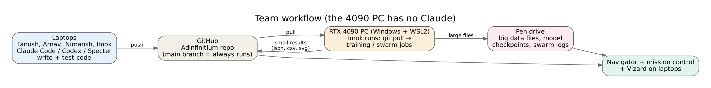

# How to use this guide

- Do the steps **in order**. Each part ends with a **CHECK**. Don't move on until the check passes.
- Commands in grey boxes are typed exactly. `#` lines are comments, so don't type them.
- If something fails, use the **Troubleshooting** table at the end, or paste the exact error into a browser AI chat.
- This guide installs tools and downloads public data. Project code comes from the GitHub repo (written on laptops).



# Part A — Windows checks (15 min)

1. **Update the NVIDIA driver** (GeForce/Studio, latest) from nvidia.com or the NVIDIA app. JAX's CUDA 13 wheels need driver ≥ 580; CUDA 12 needs ≥ 525.
2. Open **PowerShell** and run `nvidia-smi`. Note the **index numbers** of the RTX 4090 and RTX 5060.
3. **Power settings:** Sleep = Never, and turn off "turn off display" if the screen sleep stops jobs. The PC must not sleep overnight.
4. Free disk: **100+ GB** on the drive that holds WSL (usually C:).

**CHECK A:** `nvidia-smi` lists both GPUs with a recent driver version.

# Part B — Install WSL2 + Ubuntu (20–40 min)

In **PowerShell as Administrator**:

```
wsl --install -d Ubuntu-24.04
```

Reboot when asked. Ubuntu opens; create a username and password (write them down).

Create the file `C:\Users\<you>\.wslconfig` (in Notepad) to give WSL enough memory:

```
[wsl2]
memory=48GB
processors=16
swap=16GB
```

(Use about 75% of the PC's RAM and cores. Then run `wsl --shutdown` in PowerShell and reopen Ubuntu.)

Inside **Ubuntu**:

```
nvidia-smi
```

**Never install a Linux NVIDIA driver inside WSL.** The Windows driver already provides GPU access.

**CHECK B:** `nvidia-smi` inside Ubuntu shows the GPUs.

# Part C — System packages and Python (15 min)

Inside Ubuntu:

```
sudo apt update && sudo apt upgrade -y
sudo apt install -y git git-lfs build-essential python3-venv python3-pip \
  gdal-bin libgdal-dev unzip wget aria2 tmux htop graphviz
git config --global user.name "Imok"
git config --global user.email "<your github email>"
```

Make two Python environments, one for JAX (swarm + light field) and one for PyTorch (hazard + diffusion), so their CUDA libraries never clash:

```
python3 -m venv ~/venvs/adi-jax
python3 -m venv ~/venvs/adi-torch
```

**CHECK C:** `python3 --version` shows 3.11 or newer (Ubuntu 24.04 ships 3.12).

# Part D — JAX + TensorNEAT + Basilisk + science libraries (30 min)

```
source ~/venvs/adi-jax/bin/activate
pip install --upgrade pip
pip install -U "jax[cuda13]"
```

**CHECK D1 (GPU visible to JAX):**

```
python -c "import jax; print(jax.devices())"
```

You should see CUDA devices, not just CPU.

- If it fails: `pip uninstall -y jax jaxlib jax-cuda13-plugin jax-cuda13-pjrt` and then `pip install -U "jax[cuda12]"`. **Never install both the cuda12 and cuda13 versions.**
- To use only the 4090, run `export CUDA_VISIBLE_DEVICES=<4090 index>` before every job, and add it to `~/.bashrc`. The RTX 5060 is a newer architecture; hiding it avoids surprises.

Then:

```
pip install git+https://github.com/EMI-Group/tensorneat.git
pip install bsk
pip install spiceypy rasterio numpy scipy pandas matplotlib pyproj shapely \
  geopandas tqdm h5py trimesh plotly streamlit
```

**CHECK D2:**

```
python -c "import tensorneat, spiceypy, rasterio; from Basilisk import __path__; print('ok')"
```

PyTorch environment (hazard detector + diffusion):

```
deactivate
source ~/venvs/adi-torch/bin/activate
pip install --upgrade pip
```

Install PyTorch with the command from **pytorch.org → Get Started**: choose Linux / Pip / Python / the newest CUDA option. Then:

```
pip install diffusers accelerate rasterio numpy matplotlib tqdm scikit-image
```

**CHECK D3:**

```
python -c "import torch; print(torch.cuda.is_available(), torch.cuda.get_device_name(0))"
```

It should print `True` and the 4090's name.

# Part E — Folder layout

```
~/adinfinitium/                 # git clone of the repo (code only)
~/adi-data/
    lola/240m/   lola/20m/   lola/5m/
    psr/  diviner/  lend/  m3/  illumination/
    spice/
    lro_images/
~/adi-runs/                     # swarm logs, checkpoints, results (NOT in git)
```

Clone the repo:

```
cd ~ && git clone https://github.com/Imok282/Adinfinitium.git adinfinitium
```

**Keep data inside WSL (`~/adi-data`), not on `/mnt/c/...`.** Files on Windows drives are much slower from Linux.

# Part F — Data downloads (~15–25 GB)

Download in a browser or with `aria2c -x 8 <url>` inside the right folder. Check file sizes after downloading.

## F1. Terrain (LOLA) — the most important

| What | File(s) | Size | From |
|---|---|---|---|
| Coarse whole-pole search map (240 m) | `LDEM_60S_240MPP_ADJ.TIF` | ~210 MB | pgda.gsfc.nasa.gov/products/90 |
| Main map (20 m, 80–90°S) | `LDEM_80S_20MPP_ADJ.TIF`, `LDEM_80S_20MPP_ADJ_ERR.TIF`, `LDSM_80S_20MPP_ADJ.TIF` (slope), `LDEC_80S_20MPP_ADJ.TIF` (spot counts) | ~2.6 GB + ~1–4 GB each | same page |
| Permanent shadow outlines | `LPSR_80S_20MPP_ADJ_1km2` (.SHP/.DBF/.PRJ or .CSV) | ~50 MB | same page |
| 5 m site DEMs | Site 01 (Connecting ridge), Site 04 (Shackleton rim), Sites 07 and 11: LDEM + slope + count | varies | pgda.gsfc.nasa.gov/products/78 |
| 5 m pole cap (87.5–90°S) | `LDEM_875S_5M` (.IMG + .LBL), or the newer adjusted 5 m product from the PGDA page | ~1.8 GB | imbrium.mit.edu → LOLA_GDR → POLAR → SOUTH_POLE |
| Illumination (for checking our own) | Polar illumination product | varies | pgda.gsfc.nasa.gov/products/69 |

**Important facts for the code team:**

- These GeoTIFFs use **south polar stereographic X/Y in metres** and the **MOON_ME frame of DE421**.
- In the 5 m products about **90% of pixels are interpolated**. The count map (LDEC) shows which pixels have real laser data. Diffusion must train **only** on pixels with real data.

## F2. Ice evidence (for discovering ice targets)

| Layer | Where | Notes |
|---|---|---|
| Permanent-shadow regions | LPSR file above + LROC PSR Atlas (lroc.sese.asu.edu/psr) | Start here; it's the simplest |
| Diviner temperatures / cold traps | PDS Geosciences node, LRO Diviner polar products | Look for south-polar max-temperature maps |
| Neutron hydrogen (LEND / Lunar Prospector) | PDS Geosciences node, LRO LEND products | Coarse resolution; use as a "likelihood" layer |
| M3 surface-ice detections | Published with Li et al. (2018, PNAS); check its data/supplement | Optional; India link (Chandrayaan-1 instrument) |

If a layer is hard to find, **skip it and note it as "future"**. The PSR + Diviner layers are enough for v1.

## F3. SPICE kernels (Sun, Earth, Moon orientation)

From `https://naif.jpl.nasa.gov/pub/naif/generic_kernels/` into `~/adi-data/spice/`:

| Kernel | Folder | Purpose |
|---|---|---|
| `naif0012.tls` (or newest `naif00xx.tls`) | `lsk/` | Leap seconds / time |
| `de440s.bsp` (~32 MB; or full `de440.bsp`) | `spk/planets/` | Sun, Earth, Moon positions |
| `pck00011.tpc` (or newest) | `pck/` | Body radii etc. |
| `moon_pa_de440_200625.bpc` | `pck/` | Precise lunar orientation (libration) |
| `moon_de440_250416.tf` (newest `moon_de440_*.tf`; older versions are in `a_old_versions/`) | `fk/satellites/` | Lunar frames incl. `MOON_ME_DE440_ME421` |

**Frame rule:** LOLA maps are MOON_ME (DE421 convention). Use the SPICE frame `MOON_ME_DE440_ME421` when converting Sun/Earth directions into map coordinates.

**CHECK F (Arnav, from a laptop):** compute Sun azimuth/elevation at Shackleton rim for 3 dates and compare with **JPL Horizons** (ssd.jpl.nasa.gov/horizons → observer location on the Moon). The differences should be tiny.

## F4. Vizard (3D viewer) — on Windows, not WSL
Download Vizard from the Basilisk documentation (Vizard section). Basilisk saves run files that Vizard opens. Tanush prepares the terrain OBJ mesh.

# Part G — Pen-drive kit

Use a **64 GB+ pen drive formatted as exFAT**, because some files are over 4 GB and FAT32 can't hold them.

| Folder on pen drive | Contents | Direction |
|---|---|---|
| `00_READ_ME_FIRST/` | These guides (PDF + Markdown) | → 4090 PC |
| `data/` | Any data downloaded on another machine (same layout as `~/adi-data`) | → 4090 PC |
| `models/` | Trained checkpoints (light field, hazard, diffusion, best NEAT genomes) | ← 4090 PC → laptops |
| `runs/` | Swarm logs, failure heatmaps, champion missions for Vizard/Basilisk | ← 4090 PC → laptops |
| `video_assets/` | Screen recordings, Vizard captures | ← all |

**Copy from pen drive into WSL** (the pen drive usually appears as `D:` → `/mnt/d` in WSL):

```
rsync -ah --progress /mnt/d/data/ ~/adi-data/
```

**Copy results back:**

```
rsync -ah --progress ~/adi-runs/<run-name>/ /mnt/d/runs/<run-name>/
```

Eject the pen drive safely in Windows before pulling it out.

# Part H — Running jobs (every time)

```
tmux new -s train                     # keeps jobs alive if the window closes
source ~/venvs/adi-jax/bin/activate   # or adi-torch for hazard/diffusion
export CUDA_VISIBLE_DEVICES=<4090 index>
cd ~/adinfinitium && git pull
# start the job using the exact command written in the repo's README / RUNBOOK
```

- Detach from tmux with `Ctrl+B` then `D`. Re-attach with `tmux attach -t train`.
- Watch the GPU in a second window: `watch -n 2 nvidia-smi`.
- Every job must write logs and checkpoints to `~/adi-runs/<date-time-name>/`.
- Push only **small** results (JSON/CSV/PNG) to GitHub. Big files go on the pen drive.
- Before sleeping: start the overnight job, confirm GPU use is high for 5 minutes, and check that checkpoints are being saved.

# Part I — Troubleshooting

| Symptom | Fix |
|---|---|
| `nvidia-smi` not found in Ubuntu | Update the Windows NVIDIA driver; run `wsl --update` in PowerShell; reboot |
| JAX shows only CPU | Reinstall JAX (Part D); make sure only ONE of cuda12/cuda13 is installed; check `CUDA_VISIBLE_DEVICES` |
| "PJRT_Api already exists" | Both cuda12 and cuda13 plugins are installed; uninstall all JAX packages and install one |
| Out of GPU memory | Smaller swarm batch (e.g. 2,500 × 4 batches); close other GPU apps |
| WSL very slow with data | Data is on `/mnt/c`; move it to `~/adi-data` |
| `pip install bsk` fails | Try Python 3.11 (`sudo apt install python3.11-venv`) or install Basilisk on a laptop; it's needed most for Tanush's work |
| Rasterio can't open `.IMG` | Use the `.TIF` products from PGDA, or check the `.LBL` file is in the same folder |
| PC slept overnight | Windows power settings → Sleep: Never; keep it plugged in |
| Pen drive refuses big file | It's FAT32; reformat as exFAT (this erases it) |
