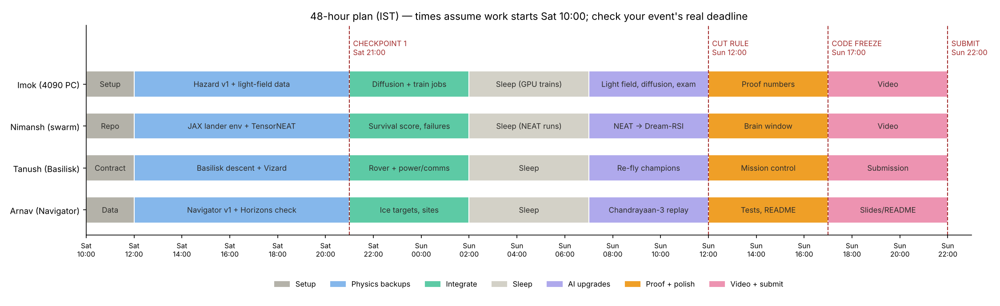

# 1. Rules everyone follows

1. **Physics backup first, AI second.** Every part must work in its simple version before its AI version.
2. **Sun 12:00 cut rule:** anything not working → its physics backup goes into the demo; the AI version becomes a "next step" slide.
3. **Sun 17:00 code freeze:** after this, only bug fixes, video and submission.
4. **`main` branch always runs.** Work on branches (`imok/hazard`, `nimansh/swarm`, and so on). Merge only when it runs.
5. **Never claim what isn't shown.** Label everything: observed · modelled · generated · unknown.
6. **Sleep 4–5 h at night (decided).** The GPU trains while you sleep, so start the overnight jobs before bed.
7. **Check the real deadline** of your local event on the Space Apps site first thing. The times below assume work starts **Sat 10:00 IST** and submission is **Sun 22:00 IST**; shift them if your deadline differs.

# 2. Timeline

| Time (IST) | Milestone |
|---|---|
| Sat 10:00 | Kick-off call (15 min): read this plan, confirm the deadline, agree the shared formats (Section 4) |
| Sat 12:00 | 4090 PC passes all setup checks; data downloaded; repo skeleton pushed |
| **Sat 21:00** | **Checkpoint 1: physics backups run end-to-end** (details in Section 3) |
| Sun 02:00 | Overnight jobs started (NEAT run, light field, diffusion), then sleep |
| Sun 07:00 | Wake; check overnight results |
| **Sun 12:00** | **Cut rule** |
| **Sun 17:00** | **Code freeze** |
| Sun 17:00–22:00 | Video, README, submission page |
| Sun 22:00 | Submit (buffer before the real deadline) |

# 3. Checkpoint 1 (Sat 21:00): what must already work

- [ ] Navigator shows the sky dome, compare view and timeline for **4 sites × 2 dates** (exact physics, no AI), checked against Horizons.
- [ ] JAX simulator flies **10,000 landers** at once with **classic guidance** on a real LOLA tile; touchdown limits are checked.
- [ ] TensorNEAT runs on the simulator (even if pilots are still bad).
- [ ] Basilisk runs orbit → release → descent with classic guidance; one Vizard replay works.
- [ ] Hazard backup (slope ≥ 12° from LDSM) and the exact light-field teacher produce maps for the demo region.
- [ ] Mission-control window shows live telemetry from one run.

If any box is unchecked at 21:00, the owner says so and the team helps before starting new work.

# 4. Shared formats (agree at kick-off)

All parts talk through simple files, so people never wait on each other.

| File | Made by | Used by | Contains |
|---|---|---|---|
| `config/mission.yaml` | Tanush | everyone | Lander/rover specs, touchdown limits, scoring weights, failure rates |
| `data/tiles/<region>.npz` | Imok | Nimansh, Tanush, Arnav | Height, slope, hazard, uncertainty, PSR mask, grid metadata (frame, metres/pixel) |
| `data/light/<region>_<date>.npz` | Imok / Arnav | Nimansh, Arnav | Sun fraction, Sun elevation, Earth elevation over time |
| `runs/<run>/generation_XXX.json` | Nimansh | brain window | Scores, survivors, champion genome, failure reasons |
| `runs/<run>/champion_XXX.json` | Nimansh | Tanush | Mission genes + control log to re-fly in Basilisk |
| `runs/<run>/telemetry_XXX.csv` | Tanush | mission control | Time, altitude, velocity, fuel, thrust, battery, comms, phase, decision |
| `sites/sites.json` | Arnav | everyone | Site library: name, lat, lon, source, notes |

**Every file includes:** units, coordinate frame, data source, and whether values are observed / modelled / generated.

# 5. Tasks by person

## Imok: 4090 PC + world-model AI (hazard, diffusion, light field) + benchmark

| # | Task | Done when | Backup |
|---|---|---|---|
| I1 | Follow guide 02 Parts A–H | All CHECKs pass | Colab for training if WSL GPU fails |
| I2 | Download data (guide 02 Part F); cut demo region tiles (coarse pole + 5 m around top candidates) | `tiles/*.npz` exist with metadata | 20 m only |
| I3 | Exact light-field teacher: horizon ray-cast + SPICE Sun/Earth for demo region, 2027–2028 | `light/*.npz` for demo sites; matches Arnav's Horizons check | — |
| I4 | Neural light field (student) | Error map vs teacher; "sun visible yes/no" errors < a few % | Use teacher outputs |
| I5 | Hazard detector | Precision/recall on **real unseen** tiles | LDSM slope threshold |
| I6 | Diffusion terrain versions | Hide-and-check error better than the error-map backup | LDEM_ERR noise |
| I7 | Unseen-terrain exam sets (hold-out regions, real sites, generated craters) | Exam files used by Nimansh | Hold-out regions only |
| I8 | Run overnight training jobs | Checkpoints saved Sun 07:00 | — |

## Nimansh: JAX simulator, evolution swarm, Dream-RSI layer, brain window

| # | Task | Done when | Backup |
|---|---|---|---|
| N1 | JAX lander environment (3-DOF first), gymnax-style | 10,000 parallel landers run on GPU | Fewer landers |
| N2 | Classic guidance baseline | Lands in the sim within limits most of the time | — |
| N3 | Surface phase: rover moves, power, battery, night, comms | Each mission gets the full score from Section 8 of the spec | Landing-only score |
| N4 | Failure injection (engine out, nav drift, camera blinded, surprise hazard) | Rates set in `mission.yaml` | Fewer failure types |
| N5 | TensorNEAT pilot (ladder ①) | Score rises over generations | Fixed network (②) |
| N6 | Dream-RSI-style meta layer (③) | Shows faster improvement than the fixed strategy | Skip, mention as next step |
| N7 | Recurrent brain (④) if time | Better under failures | Skip |
| N8 | Brain window: live network, swarm map, score, family tree, failure heatmap, AI-vs-physics, exam | Runs from `runs/` files | Static plots |

## Tanush: Basilisk modules, Vizard, mission control, integration

| # | Task | Done when | Backup |
|---|---|---|---|
| T1 | Repo skeleton, `mission.yaml`, shared formats | Pushed by Sat 12:00 | — |
| T2 | Basilisk orbit → release → deorbit scenario | Runs, produces telemetry | — |
| T3 | Basilisk modules: lunar terrain, powered-descent lander (5 engines), rover on terrain, Sun/Earth power + comms | Each runs alone, then together | Terrain + lander only |
| T4 | Re-fly champions from Nimansh's files; compare with JAX | Table of differences | — |
| T5 | Vizard: lander + rover models, LOLA terrain as OBJ | One full replay recorded | Matplotlib/Three.js render |
| T6 | Mission-control window (separate window) | Telemetry, power & comms, phase, decision log | — |
| T7 | Submission page draft | Ready Sun 17:00 | — |

## Arnav: Navigator, data checks, site library, tests

| # | Task | Done when | Backup |
|---|---|---|---|
| A1 | Site library `sites.json` (Apollo, CLPS, Chandrayaan-3, Chang'e, IM-2 area, Artemis III regions); verify coordinates from official sources | File reviewed by team | Fewer sites |
| A2 | SPICE Sun/Earth for any site and date + **Horizons comparison table** | Max error reported | — |
| A3 | Navigator: sky dome, compare (4 columns), lunar-day timeline, countdowns | Works for 4 sites × 2 dates | — |
| A4 | Ice-target layer (PSR outlines + Diviner) | Shown in Navigator | PSR only |
| A5 | Chandrayaan-3 replay (23 Aug 2023 site and date) | Sunlight/night timeline matches the real mission story | — |
| A6 | Tests: same seed gives the same result; hazards never chosen; units correct | Tests run in one command | — |
| A7 | README + "how to run" | Someone new can run the demo | — |

# 6. The 30-second video (decide the technique Sunday)

**Decided:** 60% lander · 20% rover · 20% Navigator; hero = **intelligence rising**. Technique: combine Claude and Grok video ideas (to decide Sunday). Draft beats:

1. **0–5 s:** intelligence score climbing; NEAT brain growing neurons; swarm of 10,000 dots.
2. **5–18 s:** Vizard: autonomous descent from orbit, engine-out, re-target away from a shadow, touchdown.
3. **18–24 s:** rover rolls out, dips to the ice edge, returns as the Sun sets.
4. **24–30 s:** Navigator sky dome + compare + "survived the night" + the one-line claim.

Record screen captures from Sat night onward. Don't leave it all to Sunday.

# 7. Before submitting (Sun 21:00 checklist)

- [ ] Video ≤ limit in the live submission guide (check it, since rules may have changed)
- [ ] Repo public (or as required), README explains how to run
- [ ] Every claim in the video is shown in the demo
- [ ] Limits slide/section: low-fidelity sim, interpolated terrain, generated vs observed
- [ ] Data sources and related work credited
- [ ] Team names and event correct on the submission page
