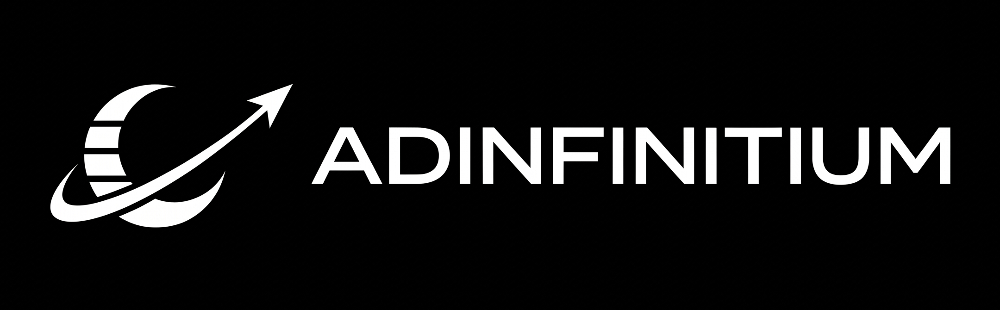
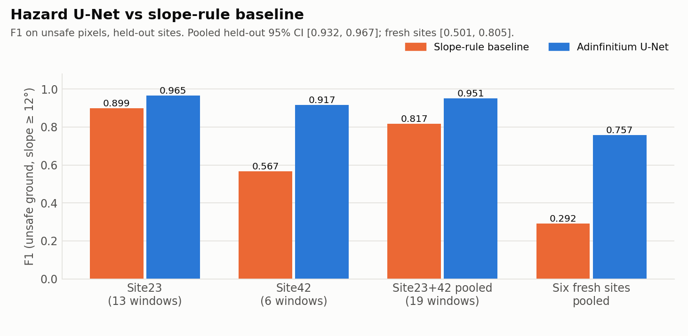
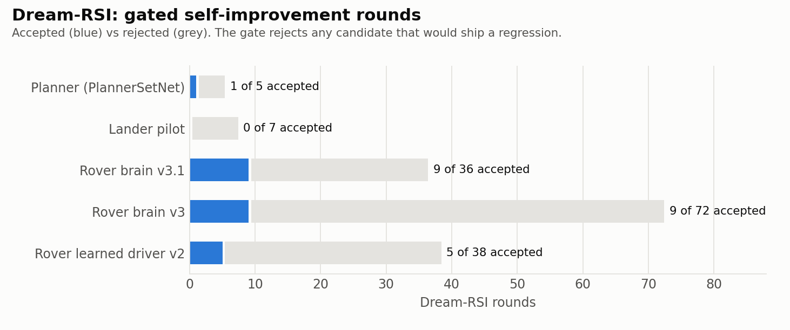

<p align="center"></p>

# Adinfinitium Hazard U-Net

**Status:** Final · **License:** Apache-2.0 · **Domain:** lunar south pole (NASA LRO LOLA 5 m)

Per-pixel unsafe-ground (slope ≥ 12°) segmentation from NASA LRO LOLA 5 m terrain, reconstructing the hazard map from the ~10% of pixels the laser actually measured.

## Model details

| | |
|---|---|
| Task | Binary segmentation of unsafe ground (NASA slope ≥ 12°), 5 m pixels |
| Parameters | **60,361,561** |
| Architecture | `AttnUNet`: residual U-Net with multi-head self-attention at the coarse scales; one logit per pixel. `in_ch 5, base 72, depth 4, blocks 2, heads 8, attn_levels 2` |
| Inputs (5 ch) | gap-filled slope over limit · high-pass height · laser mask · NASA error map · distance to nearest laser pixel |
| Training | 37 of 40 epochs (200 steps each); best checkpoint by validation F1 on Site11; train sites Site01, 04, 06, 07, 20, Haworth, Shoemaker, DM2 |
| Checkpoint | `hazard_unet_big.pt` · 241,510,445 bytes · id `cd6c4383eb` · sha256 `91393b30…672a0` |
| Wiring | Feeds the rover brain's route cost and score penalty |

## Benchmarks

F1 for unsafe pixels, network against the slope-rule baseline (gap-filled surface). Held-out = Site23 (13 windows) and Site42 (6 windows); fresh = six unseen sites (DM1, LM7, NPA–NPD).



| Test set | U-Net F1 | Slope-rule baseline F1 |
|---|---|---|
| Held-out Site23 + Site42 (19 windows) | **0.951** [0.932, 0.967] | 0.817 |
| Site23 alone (13 windows) | 0.965 | 0.899 |
| Site42 alone (6 windows) | 0.917 | 0.567 |
| Six fresh sites | **0.757** [0.501, 0.805] | 0.292 |

Fresh-site recall **81.3%**, false-alarm rate **5.1%**.

## Limitations

- Weak on flat ground: F1 0.24–0.70 at flat fresh sites (misses 38–75% of unsafe pixels on the four flat sites NPA–NPD).
- About 90% of label pixels are NASA interpolation, and only 3.7–14.2% of a test window holds a laser return; the comparison leans towards the network because the baseline's slope and NASA's error map are also network inputs.
- Haworth is 19 of the 60 training tiles.

## Usage

```python
# project code: https://github.com/oasisk/adinfinitium-handoff
from worldmodel.hazard.model import load_checkpoint, predict_probability
from worldmodel.hazard.features import build_features
model, info = load_checkpoint("hazard_unet_big.pt", device="cpu")
```

## Dream-RSI: gated offline self-improvement

Dream-RSI lets a model keep improving after the main training ends, offline and safely:

1. **Find failures**: fly or replay many missions and record where the current model fails.
2. **Dream harder**: generate and replay those hard cases (failure-boosted scenarios) and retrain a candidate, warm-started from the current model.
3. **Gate**: the candidate is scored on a frozen validation exam (fixed seeds, paired with the current model and the physics backup).
   - **Lander:** accept only if the candidate loses no mission that the current model or the physics backup lands (zero regressions) AND improves total success.
   - **Planner and rover:** accept only if the frozen validation metric improves by a margin.
4. **Repeat** from whichever model won. Rejected candidates are discarded, and the shipped model never gets worse.

Test maps and the final-exam site are never used in Dream-RSI: training uses training maps, and gating uses a separate validation map.

### Measured results (all logged rounds)



| Loop | Rounds accepted | Effect on its gate metric |
|---|---|---|
| Planner (PlannerSetNet) | 1 of 5 | Validation Brier 0.01543 → 0.01353 (−12.3%) |
| Lander pilot (Site11 gate, 1,024 paired missions) | 0 of 7 | Pilot unchanged; every candidate lost 12–25 missions, so the gate held |
| Rover brain v3.1 (self-learning on stressed worlds) | 9 of 36 | Blocked route improved at 4/4 sites, late light 3/4, dusty panels 1/4, early light 0/4 |
| Rover brain v3 | 9 of 72 | Blocked route improved at 6/6 sites, dusty panels 2/6 |
| Rover learned driver v2 | 5 of 38 | Returned rate stayed 0.0% |

Across all loops, 18 of 42 first rounds on a new problem were accepted, against 6 of 120 later rounds.
**What this shows:** Dream-RSI reliably repairs specific failures (blocked routes, late light, model faults) without ever shipping a regression. In unchanged conditions it rarely finds a safe gain (0 of 32 rover rounds accepted).

### Projections after more Dream-RSI (Projected, not measured)

Median after 20 more generations, from the planner's own Dream-RSI log:

- **Planner Brier:** 0.0145 → 0.0094 [0.0043, 0.0145]

Scenario only, for models where Dream-RSI has not been run yet (it borrows the improvement rate seen in the planner and rover loops):

- **Hazard fresh F1:** 0.757 → 0.779
- **Light error:** 0.450° → 0.410°
- **Terrain error:** 2.01 → 1.84 m

The lander and rover v3.1 are projected to stay unchanged, because their gates have not accepted anything in unchanged conditions.

### Limitations and next steps

- The zero-regression gate is strict: it also rejected lander candidates that were slightly better overall (best: 991 vs 990 landings).
- Training rounds were short (4–5 updates) because of the compute budget.
- **Next:** harder self-generated scenarios, longer rounds, and a fresh unseen-map exam after each accepted generation.

## Intended use and scope

Research, education and benchmarking of lunar landing-site navigation methods. **Not for flight, safety-critical or
operational landing decisions.** All results are simulation or held-out-lunar-site results, not real-mission performance.
Models were frozen (SHA-256) before held-out evaluation; each test site was evaluated once.

## About Adinfinitium

Adinfinitium is an open-source effort to make lunar landing and surface navigation easier to study. It began as our
NASA Space Apps 2026 project, *Lunar Landing Site Navigator*, and trains on NASA LRO LOLA 5 m terrain of the lunar south
pole. The model chain is: hazard network → light network → terrain model → rover brain → lander pilot.
See the whole family at https://huggingface.co/Imok282.

Source code, full records and the hand-off package: https://github.com/oasisk/adinfinitium-handoff (checkpoint SHA-256 values: `CHECKPOINTS.sha256`).

## Citation

```bibtex
@misc{adinfinitium2026lunar,
  title  = {Adinfinitium open models for lunar landing-site navigation},
  author = {Adinfinitium},
  year   = {2026},
  howpublished = {Hugging Face, https://huggingface.co/Imok282},
  note   = {NASA Space Apps 2026, Lunar Landing Site Navigator}
}
```
