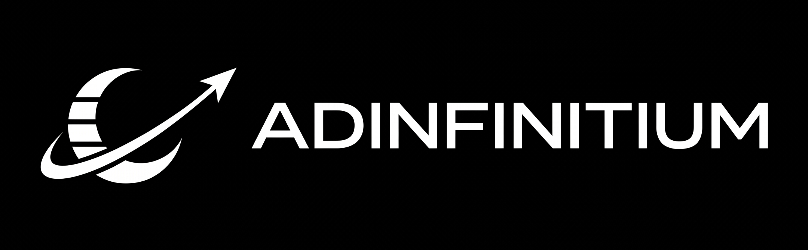
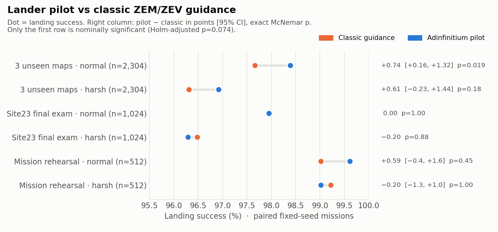
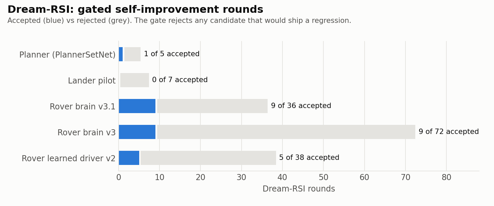

<p align="center"></p>

# Adinfinitium Lander Pilot

**Status:** Final · **License:** Apache-2.0 · **Domain:** lunar south pole (NASA LRO LOLA 5 m)

A 14.8 M-parameter transformer that learns a *residual* on top of classic ZEM/ZEV guidance for lunar terminal descent. With the residual at zero it flies exactly like classic guidance, so it can only help on top of a known-good baseline.

## Model details

| | |
|---|---|
| Task | Terminal-descent control (continuous thrust commands) |
| Parameters | **14,842,567** (counted from the released checkpoint) |
| Architecture | `PilotFormer`: conv stem cuts a 32×32 hazard-camera crop into 64 patch tokens + 24-number state token → 8-layer transformer → policy and residual heads. `d 384, layers 8, heads 8, crop 32, stem 48` |
| Control law | `action = clip(classic(obs) + 0.3 × clamp(r), −1, 1)` |
| Training | PPO; the released checkpoint was saved at update 40 (170 episodes); best recorded validation success 96.9% |
| Checkpoint | `lander_pilot.pt` · 59,409,547 bytes · id `d53a162df9` · sha256 `2501e02b…ed39c` |
| Wiring | Separate package; its camera sees the slope-rule hazard map, not the hazard U-Net |

## Benchmarks

Simplified 3-DOF terminal-descent simulation on NASA LRO LOLA 5 m terrain. Paired fixed-seed missions (pilot and classic fly identical missions).
Touchdown limits: vertical ≤ 2 m/s, horizontal ≤ 0.5 m/s, slope ≤ 12°. "Harsh" = 3× failure rates.



| Test | Classic guidance | Pilot | Difference [95% CI] | Exact McNemar p |
|---|---|---|---|---|
| 3 unseen maps (Site42, Shoemaker, DM2), normal, n=2,304 | 97.66% | **98.39%** | +0.74 pts [+0.16, +1.32] | 0.019 (Holm-adjusted 0.074) |
| 3 unseen maps, harsh (3× failure rates), n=2,304 | 96.31% | 96.92% | +0.61 pts [−0.23, +1.44] | 0.18 |
| Site23 final exam (flown once), normal, n=1,024 | 97.95% | 97.95% | 0.00 | 1.00 |
| Site23 final exam, harsh, n=1,024 | 96.48% | 96.29% | −0.20 pts | 0.88 |
| Mission rehearsal at planned landing cell (Site23, 2027-03-17), normal, n=512 | 99.02% | **99.61%** | +0.59 pts [−0.4, +1.6] | 0.45 |
| Mission rehearsal, harsh, n=512 | 99.22% | 99.02% | −0.20 pts [−1.3, +1.0] | 1.00 |

Also measured (unseen maps): **9% less fuel** (65.0 vs 71.5 kg), same miss distance (4.07 vs 4.10 m).

## Limitations

- Worse than classic after an engine-out (95.9% vs 98.4%).
- The unseen-map gain comes from Site42 only; Shoemaker and DM2 are ties, and on the Site23 final exam the pilot is not better than classic.
- Most crashes are sideways touchdowns at 0.51–0.78 m/s against the 0.5 m/s limit; the residual is capped at 0.3 of full thrust.
- Only the first benchmark row is nominally significant, and it does not survive Holm correction (p = 0.074).
- Simplified 3-DOF simulation; not validated against flight dynamics.

## Usage

```python
# project code: https://github.com/oasisk/adinfinitium-handoff  (adinfinitium_lander/worldmodel/lander/pilot.py)
from worldmodel.lander.pilot import load_checkpoint
model, info = load_checkpoint("lander_pilot.pt", device="cpu")   # also sets model.rule from info["residual_rule"]
```

## Dream-RSI: gated offline self-improvement

Dream-RSI lets a model keep improving after the main training ends, offline and safely:

1. **Find failures**: fly or replay many missions and record where the current model fails.
2. **Dream harder**: generate and replay those hard cases (failure-boosted scenarios) and retrain a candidate, warm-started from the current model.
3. **Gate**: the candidate is scored on a frozen validation exam (fixed seeds, paired with the current model and the physics backup).
   - **Lander:** accept only if the candidate loses no mission that the current model or the physics backup lands (zero regressions) AND improves total success.
   - **Planner and rover:** accept only if the frozen validation metric improves by a margin.
4. **Repeat** from whichever model won. Rejected candidates are discarded, and the shipped model never gets worse.

Test maps and the final-exam site are never used in Dream-RSI: training uses training maps, and gating uses a separate validation map.

### Measured results (all logged rounds)



| Loop | Rounds accepted | Effect on its gate metric |
|---|---|---|
| Planner (PlannerSetNet) | 1 of 5 | Validation Brier 0.01543 → 0.01353 (−12.3%) |
| Lander pilot (Site11 gate, 1,024 paired missions) | 0 of 7 | Pilot unchanged; every candidate lost 12–25 missions, so the gate held |
| Rover brain v3.1 (self-learning on stressed worlds) | 9 of 36 | Blocked route improved at 4/4 sites, late light 3/4, dusty panels 1/4, early light 0/4 |
| Rover brain v3 | 9 of 72 | Blocked route improved at 6/6 sites, dusty panels 2/6 |
| Rover learned driver v2 | 5 of 38 | Returned rate stayed 0.0% |

Across all loops, 18 of 42 first rounds on a new problem were accepted, against 6 of 120 later rounds.
**What this shows:** Dream-RSI reliably repairs specific failures (blocked routes, late light, model faults) without ever shipping a regression. In unchanged conditions it rarely finds a safe gain (0 of 32 rover rounds accepted).

### Projections after more Dream-RSI (Projected, not measured)

Median after 20 more generations, from the planner's own Dream-RSI log:

- **Planner Brier:** 0.0145 → 0.0094 [0.0043, 0.0145]

Scenario only, for models where Dream-RSI has not been run yet (it borrows the improvement rate seen in the planner and rover loops):

- **Hazard fresh F1:** 0.757 → 0.779
- **Light error:** 0.450° → 0.410°
- **Terrain error:** 2.01 → 1.84 m

The lander and rover v3.1 are projected to stay unchanged, because their gates have not accepted anything in unchanged conditions.

### Limitations and next steps

- The zero-regression gate is strict: it also rejected lander candidates that were slightly better overall (best: 991 vs 990 landings).
- Training rounds were short (4–5 updates) because of the compute budget.
- **Next:** harder self-generated scenarios, longer rounds, and a fresh unseen-map exam after each accepted generation.

## Intended use and scope

Research, education and benchmarking of lunar landing-site navigation methods. **Not for flight, safety-critical or
operational landing decisions.** All results are simulation or held-out-lunar-site results, not real-mission performance.
Models were frozen (SHA-256) before held-out evaluation; each test site was evaluated once.

## About Adinfinitium

Adinfinitium is an open-source effort to make lunar landing and surface navigation easier to study. It began as our
NASA Space Apps 2026 project, *Lunar Landing Site Navigator*, and trains on NASA LRO LOLA 5 m terrain of the lunar south
pole. The model chain is: hazard network → light network → terrain model → rover brain → lander pilot.
See the whole family at https://huggingface.co/Imok282.

Source code, full records and the hand-off package: https://github.com/oasisk/adinfinitium-handoff (checkpoint SHA-256 values: `CHECKPOINTS.sha256`).

## Citation

```bibtex
@misc{adinfinitium2026lunar,
  title  = {Adinfinitium open models for lunar landing-site navigation},
  author = {Adinfinitium},
  year   = {2026},
  howpublished = {Hugging Face, https://huggingface.co/Imok282},
  note   = {NASA Space Apps 2026, Lunar Landing Site Navigator}
}
```
