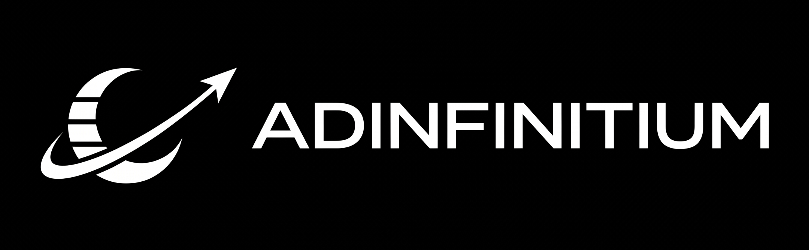
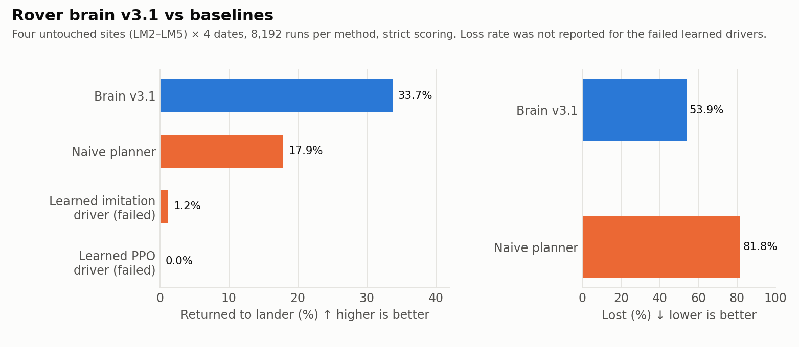
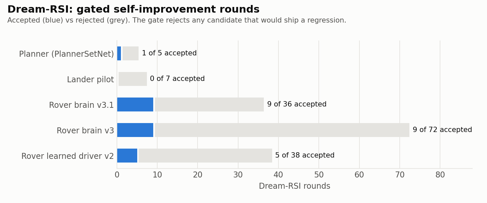

<p align="center"></p>

# Adinfinitium Rover Brain v3 / v3.1 (scripted planner)

**Status:** Final · **License:** Apache-2.0 · **Domain:** lunar south pole (NASA LRO LOLA 5 m)

A scripted rover brain with **no learned parameters** that rolls 36+ candidate plans per rover inside its own world model and follows the best one, plus a gated self-learning layer. This is the rover model Adinfinitium presents. This repo holds the deployed configuration files, not weights.

## Model details

| | |
|---|---|
| Task | Rover navigation to ice and return to the lander under power/thermal constraints |
| Parameters | **0 learned** (v3: 5 KB config · v3.1: 11 KB config) |
| Method | Planner rolls candidate plans to the end of the episode (waits at the lander, charge or not, three baseline planners, safe harbour); hour-by-hour executor; Dream-RSI layer adapts belief map, belief solar output, energy margin and charge thresholds |
| v3.1 additions | stay-alive route search, 31 new candidate plans, strict-first choice rule, waypoint executor, two new self-learning proposal types (light shifted in time; battery capacity) |
| Files | `rover_brain_v3_config.json`, `rover_brain_v31_config.json` |
| Depends on | [lunar-hazard-unet](https://huggingface.co/Imok282/lunar-hazard-unet) for the hazard map |

## Benchmarks

Four untouched sites (LM2–LM5) × 4 dates, 8,192 runs per method, strict scoring (an empty battery anywhere counts as a lost rover).



| Method | Returned | Lost |
|---|---|---|
| Rover brain v3.1 | **33.7%** | 53.9% |
| Naive planner | 17.9% | 81.8% |
| Learned PPO driver (11.4 M, [deprecated](https://huggingface.co/Imok282/lunar-rover-driver-v1)) | 0.0% | – (failed) |
| Learned imitation driver ([deprecated](https://huggingface.co/Imok282/lunar-rover-driver-v2)) | 1.2% | – (failed) |

v3.1 versus v3 on the same sites: lost **−7.1 points** [−13.8, −3.5], lower at 4 of 4 sites (v3: 31.0% returned, 61.0% lost). On six fresh sites, v3 under the simulator's lenient rule returned 59.6% with 0.0% lost; under the strict rule 42.0% / 56.7%.

## Limitations

- v3.1 still loses more than half its rovers; of the 583 rovers it saved, 419 only stayed alive on lit ground without completing a trip.
- The v3 "lost none" result came from a simulator rule that forgives an empty battery within 20 m of the lander.
- With a wrong belief it loses more rovers than v3 under the lenient rule (late forecast 32.2% vs 19.9%); the four v3.1 test sites are neighbours, so the interval is rough.
- Not a learned driver: do not describe it as one.

## Usage

```bash
# project code: https://github.com/oasisk/adinfinitium-handoff
python -m worldmodel.rover3.run eval          # stages: eval, changed, dream, dream-all, dream31, dream31-all
```
Load `rover_brain_v31_config.json` into `Theta(v31=True)`; frozen v3 is `Theta()`.

## Dream-RSI: gated offline self-improvement

Dream-RSI lets a model keep improving after the main training ends, offline and safely:

1. **Find failures**: fly or replay many missions and record where the current model fails.
2. **Dream harder**: generate and replay those hard cases (failure-boosted scenarios) and retrain a candidate, warm-started from the current model.
3. **Gate**: the candidate is scored on a frozen validation exam (fixed seeds, paired with the current model and the physics backup).
   - **Lander:** accept only if the candidate loses no mission that the current model or the physics backup lands (zero regressions) AND improves total success.
   - **Planner and rover:** accept only if the frozen validation metric improves by a margin.
4. **Repeat** from whichever model won. Rejected candidates are discarded, and the shipped model never gets worse.

Test maps and the final-exam site are never used in Dream-RSI: training uses training maps, and gating uses a separate validation map.

### Measured results (all logged rounds)



| Loop | Rounds accepted | Effect on its gate metric |
|---|---|---|
| Planner (PlannerSetNet) | 1 of 5 | Validation Brier 0.01543 → 0.01353 (−12.3%) |
| Lander pilot (Site11 gate, 1,024 paired missions) | 0 of 7 | Pilot unchanged; every candidate lost 12–25 missions, so the gate held |
| Rover brain v3.1 (self-learning on stressed worlds) | 9 of 36 | Blocked route improved at 4/4 sites, late light 3/4, dusty panels 1/4, early light 0/4 |
| Rover brain v3 | 9 of 72 | Blocked route improved at 6/6 sites, dusty panels 2/6 |
| Rover learned driver v2 | 5 of 38 | Returned rate stayed 0.0% |

Across all loops, 18 of 42 first rounds on a new problem were accepted, against 6 of 120 later rounds.
**What this shows:** Dream-RSI reliably repairs specific failures (blocked routes, late light, model faults) without ever shipping a regression. In unchanged conditions it rarely finds a safe gain (0 of 32 rover rounds accepted).

### Projections after more Dream-RSI (Projected, not measured)

Median after 20 more generations, from the planner's own Dream-RSI log:

- **Planner Brier:** 0.0145 → 0.0094 [0.0043, 0.0145]

Scenario only, for models where Dream-RSI has not been run yet (it borrows the improvement rate seen in the planner and rover loops):

- **Hazard fresh F1:** 0.757 → 0.779
- **Light error:** 0.450° → 0.410°
- **Terrain error:** 2.01 → 1.84 m

The lander and rover v3.1 are projected to stay unchanged, because their gates have not accepted anything in unchanged conditions.

### Limitations and next steps

- The zero-regression gate is strict: it also rejected lander candidates that were slightly better overall (best: 991 vs 990 landings).
- Training rounds were short (4–5 updates) because of the compute budget.
- **Next:** harder self-generated scenarios, longer rounds, and a fresh unseen-map exam after each accepted generation.

## Intended use and scope

Research, education and benchmarking of lunar landing-site navigation methods. **Not for flight, safety-critical or
operational landing decisions.** All results are simulation or held-out-lunar-site results, not real-mission performance.
Models were frozen (SHA-256) before held-out evaluation; each test site was evaluated once.

## About Adinfinitium

Adinfinitium is an open-source effort to make lunar landing and surface navigation easier to study. It began as our
NASA Space Apps 2026 project, *Lunar Landing Site Navigator*, and trains on NASA LRO LOLA 5 m terrain of the lunar south
pole. The model chain is: hazard network → light network → terrain model → rover brain → lander pilot.
See the whole family at https://huggingface.co/Imok282.

Source code, full records and the hand-off package: https://github.com/oasisk/adinfinitium-handoff (checkpoint SHA-256 values: `CHECKPOINTS.sha256`).

## Citation

```bibtex
@misc{adinfinitium2026lunar,
  title  = {Adinfinitium open models for lunar landing-site navigation},
  author = {Adinfinitium},
  year   = {2026},
  howpublished = {Hugging Face, https://huggingface.co/Imok282},
  note   = {NASA Space Apps 2026, Lunar Landing Site Navigator}
}
```
