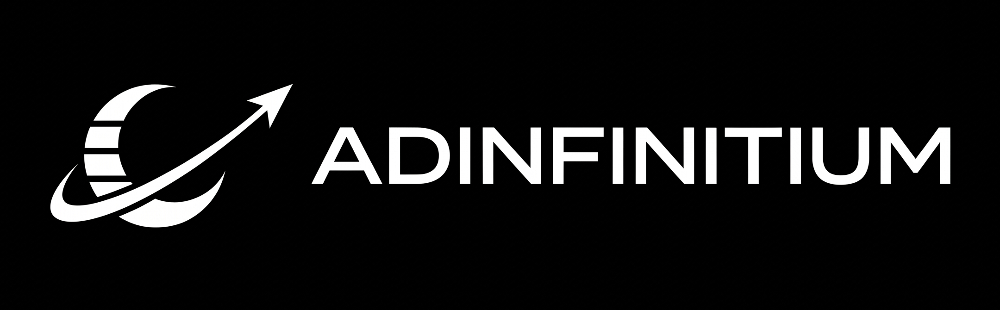
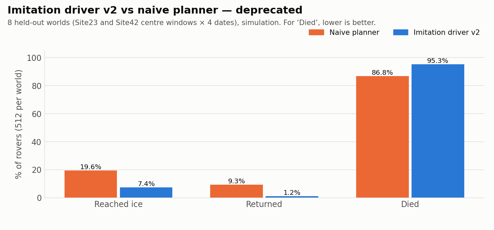
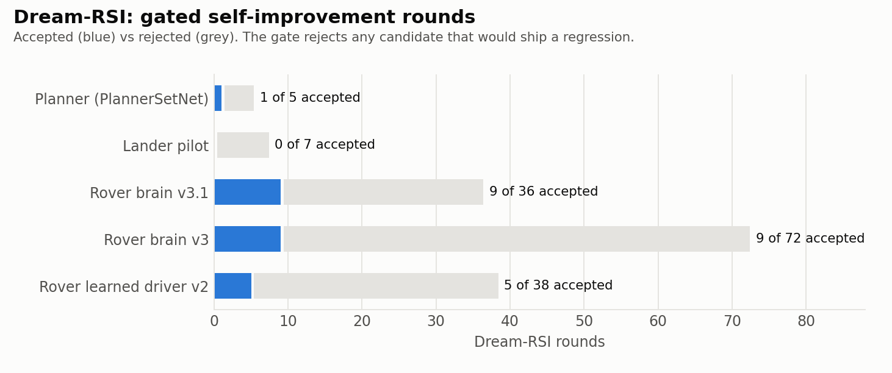

<p align="center"></p>

# Adinfinitium Rover Driver v2 (imitation / DAgger) — DEPRECATED

**Status:** Deprecated (failed; research record) · **License:** Apache-2.0 · **Domain:** lunar south pole (NASA LRO LOLA 5 m)

> ⚠️ **DEPRECATED MODEL.** This checkpoint did not meet its pre-registered success criteria and is superseded by the
> scripted [lunar-rover-brain](https://huggingface.co/Imok282/lunar-rover-brain) (v3 / v3.1). It is kept online only as a
> transparent research record of a negative result. **Do not use it for planning or navigation.**

Same `DriverFormer` network as v1, trained by imitation with DAgger from six planner variants. Pre-registered verdict: failure. Published as a research record.

## Model details

| | |
|---|---|
| Task | Rover driving policy (imitation of scripted planners) |
| Parameters | **11,377,354** |
| Architecture | `DriverFormer` (as v1): `d 384, layers 6, heads 8, crop 64, stem 64` |
| Training | DAgger imitation; 105 episodes, 14,605 steps, 110 minutes over 32 training worlds; selected on validation Site11 (candidate 6 of 9) |
| Checkpoint | `rover_driver_v2.pt` · 45,543,277 bytes · id `60985f9de2` · sha256 `cecdf244…79375` |

## Benchmarks

8 held-out worlds (Site23 and Site42 × 4 dates), simulation only. Pre-registered verdict: **FAILURE**.



| | Reached ice | Returned | Died |
|---|---|---|---|
| This policy | 7.4% | 1.2% | 95.3% |
| Naive planner | 19.6% | 9.3% | 86.8% |

On Site11 (validation) it returned 26.8% against the planner's 40.7%.

## Limitations

- It memorised routes: it agrees with the planner on 86–93% of return-leg steps on trained terrain but only 15–26% on unseen terrain.
- Site11 was an easy validation site; training site Site04 is 99.5% over the slope limit and taught nothing.
- Dream-RSI on top of it accepted 5 of 38 rounds, but its returned rate stayed 0.0%.

## Usage

Not recommended. Loader for research: `worldmodel.rover.policy.load_checkpoint` (project code on GitHub).

## Dream-RSI: gated offline self-improvement

Dream-RSI lets a model keep improving after the main training ends, offline and safely:

1. **Find failures**: fly or replay many missions and record where the current model fails.
2. **Dream harder**: generate and replay those hard cases (failure-boosted scenarios) and retrain a candidate, warm-started from the current model.
3. **Gate**: the candidate is scored on a frozen validation exam (fixed seeds, paired with the current model and the physics backup).
   - **Lander:** accept only if the candidate loses no mission that the current model or the physics backup lands (zero regressions) AND improves total success.
   - **Planner and rover:** accept only if the frozen validation metric improves by a margin.
4. **Repeat** from whichever model won. Rejected candidates are discarded, and the shipped model never gets worse.

Test maps and the final-exam site are never used in Dream-RSI: training uses training maps, and gating uses a separate validation map.

### Measured results (all logged rounds)



| Loop | Rounds accepted | Effect on its gate metric |
|---|---|---|
| Planner (PlannerSetNet) | 1 of 5 | Validation Brier 0.01543 → 0.01353 (−12.3%) |
| Lander pilot (Site11 gate, 1,024 paired missions) | 0 of 7 | Pilot unchanged; every candidate lost 12–25 missions, so the gate held |
| Rover brain v3.1 (self-learning on stressed worlds) | 9 of 36 | Blocked route improved at 4/4 sites, late light 3/4, dusty panels 1/4, early light 0/4 |
| Rover brain v3 | 9 of 72 | Blocked route improved at 6/6 sites, dusty panels 2/6 |
| Rover learned driver v2 | 5 of 38 | Returned rate stayed 0.0% |

Across all loops, 18 of 42 first rounds on a new problem were accepted, against 6 of 120 later rounds.
**What this shows:** Dream-RSI reliably repairs specific failures (blocked routes, late light, model faults) without ever shipping a regression. In unchanged conditions it rarely finds a safe gain (0 of 32 rover rounds accepted).

### Projections after more Dream-RSI (Projected, not measured)

Median after 20 more generations, from the planner's own Dream-RSI log:

- **Planner Brier:** 0.0145 → 0.0094 [0.0043, 0.0145]

Scenario only, for models where Dream-RSI has not been run yet (it borrows the improvement rate seen in the planner and rover loops):

- **Hazard fresh F1:** 0.757 → 0.779
- **Light error:** 0.450° → 0.410°
- **Terrain error:** 2.01 → 1.84 m

The lander and rover v3.1 are projected to stay unchanged, because their gates have not accepted anything in unchanged conditions.

### Limitations and next steps

- The zero-regression gate is strict: it also rejected lander candidates that were slightly better overall (best: 991 vs 990 landings).
- Training rounds were short (4–5 updates) because of the compute budget.
- **Next:** harder self-generated scenarios, longer rounds, and a fresh unseen-map exam after each accepted generation.

## Intended use and scope

Research, education and benchmarking of lunar landing-site navigation methods. **Not for flight, safety-critical or
operational landing decisions.** All results are simulation or held-out-lunar-site results, not real-mission performance.
Models were frozen (SHA-256) before held-out evaluation; each test site was evaluated once.

## About Adinfinitium

Adinfinitium is an open-source effort to make lunar landing and surface navigation easier to study. It began as our
NASA Space Apps 2026 project, *Lunar Landing Site Navigator*, and trains on NASA LRO LOLA 5 m terrain of the lunar south
pole. The model chain is: hazard network → light network → terrain model → rover brain → lander pilot.
See the whole family at https://huggingface.co/Imok282.

Source code, full records and the hand-off package: https://github.com/oasisk/adinfinitium-handoff (checkpoint SHA-256 values: `CHECKPOINTS.sha256`).

## Citation

```bibtex
@misc{adinfinitium2026lunar,
  title  = {Adinfinitium open models for lunar landing-site navigation},
  author = {Adinfinitium},
  year   = {2026},
  howpublished = {Hugging Face, https://huggingface.co/Imok282},
  note   = {NASA Space Apps 2026, Lunar Landing Site Navigator}
}
```
