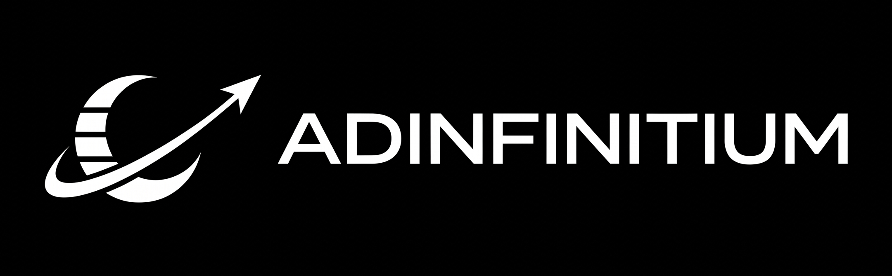
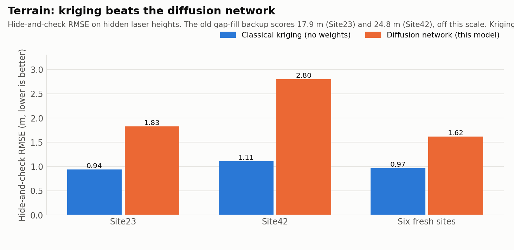
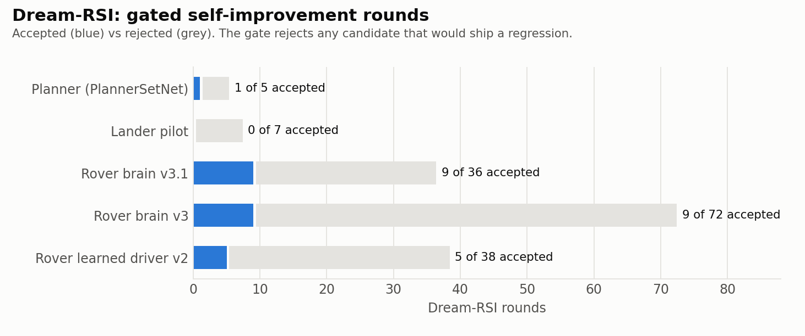

<p align="center"></p>

# Adinfinitium Terrain Diffusion (experimental)

**Status:** Experimental · **License:** Apache-2.0 · **Domain:** lunar south pole (NASA LRO LOLA 5 m)

Conditional diffusion U-Net that fills terrain height between laser points on 64×64-pixel patches. **Experimental:** classical kriging scores better, so kriging is the estimator we ship. Outputs are always labelled GENERATED – NOT OBSERVED.

## Model details

| | |
|---|---|
| Task | Terrain-height gap filling (hide-and-check) |
| Parameters | **49,943,681** |
| Architecture | `DenoiseAttnUNet`: conditional denoiser, residual blocks, time embedding, self-attention at coarse scales. `base 128, depth 3, T 100, blocks 2, heads 8, attn_levels 2` |
| Training | 7,671 of 8,000 steps; best = step 7,500; trained only on laser-measured pixels by hide-and-check |
| Checkpoint | `terrain_diffusion_mini.pt` · 199,839,435 bytes · id `1f647a8660` · sha256 `1a8bfbad…0e643` |
| Wiring | Read by nothing downstream |

## Benchmarks

Kriging scores **0.97 m** RMSE and the network **2.01 m** on the held-out sites, so kriging is the shipped estimator and this model is an experiment.



| Hide-and-check RMSE on hidden laser heights (m, lower is better) | Kriging | Diffusion network | Old gap-fill backup |
|---|---|---|---|
| Site23 | **0.94** | 1.83 | 17.92 |
| Site42 | **1.11** | 2.80 | 24.82 |
| Six fresh sites | **0.97** | 1.62 | n/a |

Uncertainty band: the raw 5–95% band fails (21.9% / 37.3% coverage on Site23 / Site42). One split-conformal scale (8.232, fit on Site11 only) gives 84.9% / 96.9% coverage, but the band is wide (7.06 m / 15.51 m).

## Limitations

- Seven of nine classical methods, including plain linear interpolation, beat the network on both held-out sites; a fitted combination puts weight 0.0064 on it.
- The test favours interpolation because hidden pixels sit next to shown ones; wide gaps were never tested for either method.
- The calibrated band is wide and uneven (6 of 19 windows outside 80–97% coverage), with no formal guarantee.

## Usage

```python
# project code: https://github.com/oasisk/adinfinitium-handoff
from worldmodel.terrain.model import load_checkpoint
from worldmodel.terrain.generate import generate_versions
```

## Dream-RSI: gated offline self-improvement

Dream-RSI lets a model keep improving after the main training ends, offline and safely:

1. **Find failures**: fly or replay many missions and record where the current model fails.
2. **Dream harder**: generate and replay those hard cases (failure-boosted scenarios) and retrain a candidate, warm-started from the current model.
3. **Gate**: the candidate is scored on a frozen validation exam (fixed seeds, paired with the current model and the physics backup).
   - **Lander:** accept only if the candidate loses no mission that the current model or the physics backup lands (zero regressions) AND improves total success.
   - **Planner and rover:** accept only if the frozen validation metric improves by a margin.
4. **Repeat** from whichever model won. Rejected candidates are discarded, and the shipped model never gets worse.

Test maps and the final-exam site are never used in Dream-RSI: training uses training maps, and gating uses a separate validation map.

### Measured results (all logged rounds)



| Loop | Rounds accepted | Effect on its gate metric |
|---|---|---|
| Planner (PlannerSetNet) | 1 of 5 | Validation Brier 0.01543 → 0.01353 (−12.3%) |
| Lander pilot (Site11 gate, 1,024 paired missions) | 0 of 7 | Pilot unchanged; every candidate lost 12–25 missions, so the gate held |
| Rover brain v3.1 (self-learning on stressed worlds) | 9 of 36 | Blocked route improved at 4/4 sites, late light 3/4, dusty panels 1/4, early light 0/4 |
| Rover brain v3 | 9 of 72 | Blocked route improved at 6/6 sites, dusty panels 2/6 |
| Rover learned driver v2 | 5 of 38 | Returned rate stayed 0.0% |

Across all loops, 18 of 42 first rounds on a new problem were accepted, against 6 of 120 later rounds.
**What this shows:** Dream-RSI reliably repairs specific failures (blocked routes, late light, model faults) without ever shipping a regression. In unchanged conditions it rarely finds a safe gain (0 of 32 rover rounds accepted).

### Projections after more Dream-RSI (Projected, not measured)

Median after 20 more generations, from the planner's own Dream-RSI log:

- **Planner Brier:** 0.0145 → 0.0094 [0.0043, 0.0145]

Scenario only, for models where Dream-RSI has not been run yet (it borrows the improvement rate seen in the planner and rover loops):

- **Hazard fresh F1:** 0.757 → 0.779
- **Light error:** 0.450° → 0.410°
- **Terrain error:** 2.01 → 1.84 m

The lander and rover v3.1 are projected to stay unchanged, because their gates have not accepted anything in unchanged conditions.

### Limitations and next steps

- The zero-regression gate is strict: it also rejected lander candidates that were slightly better overall (best: 991 vs 990 landings).
- Training rounds were short (4–5 updates) because of the compute budget.
- **Next:** harder self-generated scenarios, longer rounds, and a fresh unseen-map exam after each accepted generation.

## Intended use and scope

Research, education and benchmarking of lunar landing-site navigation methods. **Not for flight, safety-critical or
operational landing decisions.** All results are simulation or held-out-lunar-site results, not real-mission performance.
Models were frozen (SHA-256) before held-out evaluation; each test site was evaluated once.

## About Adinfinitium

Adinfinitium is an open-source effort to make lunar landing and surface navigation easier to study. It began as our
NASA Space Apps 2026 project, *Lunar Landing Site Navigator*, and trains on NASA LRO LOLA 5 m terrain of the lunar south
pole. The model chain is: hazard network → light network → terrain model → rover brain → lander pilot.
See the whole family at https://huggingface.co/Imok282.

Source code, full records and the hand-off package: https://github.com/oasisk/adinfinitium-handoff (checkpoint SHA-256 values: `CHECKPOINTS.sha256`).

## Citation

```bibtex
@misc{adinfinitium2026lunar,
  title  = {Adinfinitium open models for lunar landing-site navigation},
  author = {Adinfinitium},
  year   = {2026},
  howpublished = {Hugging Face, https://huggingface.co/Imok282},
  note   = {NASA Space Apps 2026, Lunar Landing Site Navigator}
}
```
